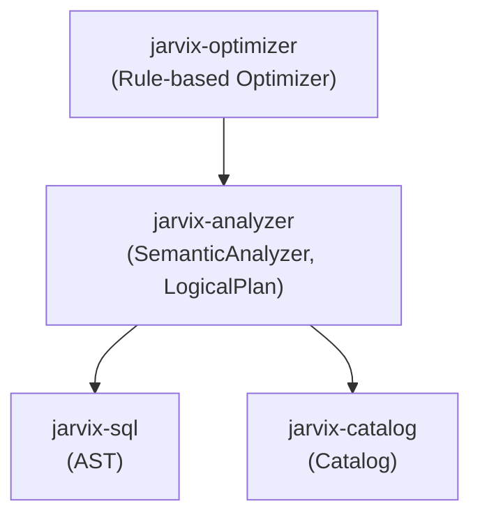

# `jarvix-analyzer`

## 1. Responsibilities & Purpose

`jarvix-analyzer` performs semantic analysis on the raw SQL Abstract Syntax Tree (AST) generated by `jarvix-sql`.

It exists to:
- Resolve table names against the `Catalog` to verify table existence.
- Bind column names to their exact integer schema indices and data types.
- Validate type compatibility in expressions (e.g. preventing integer + string additions).
- Convert an unverified AST into a semantically valid **Logical Query Plan** (`LogicalPlan`, `LogicalScan`, `LogicalFilter`, `LogicalProjection`).

---

## 2. File Organization

| File | Purpose |
|---|---|
| `src/lib.rs` | Complete semantic analyzer and logical plan representation: `SemanticAnalyzer`, `LogicalPlan`, `LogicalExpr`, and type resolution. |

---

## 3. Subsystem Interactions & Dependencies



- **Depends On**: `jarvix-common`, `jarvix-sql`, `jarvix-catalog`.
- **Depended On By**: `jarvix-optimizer`, `jarvix-executor`, `jarvix-server`.

---

## 4. Rust Learning for Database Engineers

### 4.1 Transforming AST Enums into Logical Expressions
```rust
pub enum LogicalExpr {
    Column { index: usize, name: String, data_type: DataType },
    Literal(Value),
    BinaryOp {
        left: Box<LogicalExpr>,
        op: BinaryOperator,
        right: Box<LogicalExpr>,
    },
}
```
- In the AST (`jarvix-sql`), a column was just a name (`Expr::Identifier("age")`).
- The semantic analyzer looks up the catalog and enriches it into `LogicalExpr::Column { index: 2, name: "age", data_type: DataType::Integer }`.
- Downstream executors can access tuple values directly by vector index (`tuple.get(2)`) without performing slow string lookups at runtime!

### 4.2 Handling Validation Errors Gracefully
Semantic errors (e.g. `"Table 'users' does not exist"`, `"Column 'score' not found"`) are returned as typed `JarvixError::Catalog` or `JarvixError::Semantic` variants using `Result<LogicalPlan>`.
