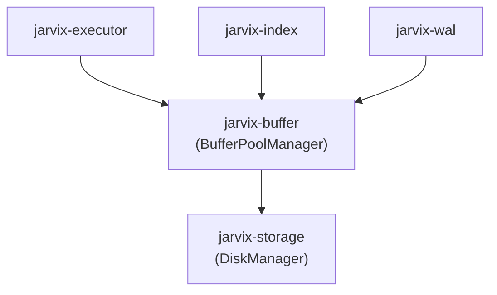

# `jarvix-buffer`

## 1. Responsibilities & Purpose

`jarvix-buffer` is responsible for caching database disk pages in memory, managing frame allocation, pin counting, dirty page writes, and page replacement policies.

It exists to:
- Prevent expensive repeated disk I/O operations by maintaining an in-memory frame cache.
- Implement the second-chance Clock eviction algorithm (`ClockReplacer`).
- Guarantee memory safety and automated pin/unpin tracking using Rust RAII guards (`PageReadGuard` and `PageWriteGuard`).

---

## 2. File Organization

| File | Purpose |
|---|---|
| `src/replacer.rs` | `ClockReplacer`: Implements circular clock-hand second-chance page eviction. |
| `src/frame.rs` | Frame metadata: `pin_count: AtomicU32`, `is_dirty: AtomicBool`, and `page_id: AtomicU32`. |
| `src/guard.rs` | RAII guards `PageReadGuard` and `PageWriteGuard` implementing `Deref`, `DerefMut`, and `Drop`. |
| `src/manager.rs` | `BufferPoolManager` and `BufferPoolInner`: Manages frame arrays, free list, page table, and page fetch/new/flush routines. |
| `src/lib.rs` | Crate root exposing buffer pool types and guards. |

---

## 3. Subsystem Interactions & Dependencies



- **Depends On**: `jarvix-common`, `jarvix-storage`.
- **Depended On By**: `jarvix-index`, `jarvix-executor`, `jarvix-wal`, `jarvix-server`.

---

## 4. Rust Learning for Database Engineers

### 4.1 The RAII Guard Pattern (`Deref` and `Drop`)
```rust
pub struct PageReadGuard<'a> {
    pub(crate) frame_id: FrameId,
    pub(crate) guard: RwLockReadGuard<'a, Page>,
    pub(crate) inner: Arc<BufferPoolInner>,
}

impl<'a> Drop for PageReadGuard<'a> {
    fn drop(&mut self) {
        self.inner.unpin_frame(self.frame_id, false);
    }
}
```
- **Why this solves buffer starvation**: In traditional C database engines, forgetting to call `unpin()` causes permanent buffer leaks. In Rust, `Drop` is called automatically as soon as the guard variable leaves the query's scope!
- **Deref Coercion**: By implementing `Deref<Target = Page>`, callers can invoke page methods (`read_guard.get_tuple(...)`) directly on the guard without boilerplate.

### 4.2 Fine-Grained Concurrency with `RwLock<Page>`
Instead of protecting the entire buffer pool with one giant lock:
- The buffer pool frame array is an array of independent `RwLock<Page>` instances.
- Multiple threads reading different pages (or even the same page) proceed in parallel with zero lock contention!
