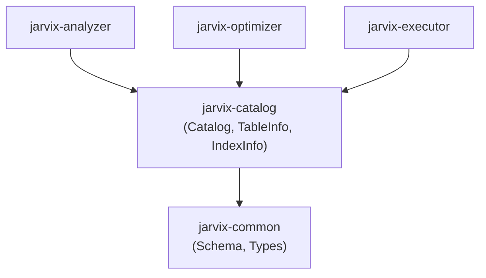

# `jarvix-catalog`

## 1. Responsibilities & Purpose

`jarvix-catalog` is the metadata management system for JavixDB. It stores definitions of tables, columns, data types, constraints, and secondary B+Tree indexes.

It exists to:
- Provide an OID (Object Identifier) allocator modeled after PostgreSQL.
- Maintain fast bidirectional lookup tables (by object name and by OID).
- Serve schema metadata to semantic analyzers, query optimizers, and query executors.
- Support dynamic DDL updates (`CREATE TABLE`, `CREATE INDEX`, `DROP TABLE`).

---

## 2. File Organization

| File | Purpose |
|---|---|
| `src/lib.rs` | Complete catalog implementation: `Catalog`, `TableInfo`, and `IndexInfo` with table/index registration, lookup, and root page updates. |

---

## 3. Subsystem Interactions & Dependencies



- **Depends On**: `jarvix-common`.
- **Depended On By**: `jarvix-analyzer`, `jarvix-optimizer`, `jarvix-executor`, `jarvix-server`.

---

## 4. Rust Learning for Database Engineers

### 4.1 Returning Immutable Borrows (`&TableInfo`)
```rust
pub fn get_table(&self, name: &str) -> Option<&TableInfo> {
    self.tables.get(&name.to_lowercase())
}
```
- In Rust, returning `Option<&TableInfo>` borrows directly from the internal `HashMap`.
- It costs zero allocations, and the compiler ensures the caller cannot mutate the catalog while holding this borrow!

### 4.2 Flexible String Arguments with `impl Into<String>`
```rust
pub fn create_table(
    &mut self,
    name: impl Into<String>,
    schema: Schema,
    first_page_id: PageId,
) -> Result<&TableInfo>
```
- Using `impl Into<String>` accepts both `&str` string slices and owned `String`s without forcing the caller to explicitly call `.to_string()`.
