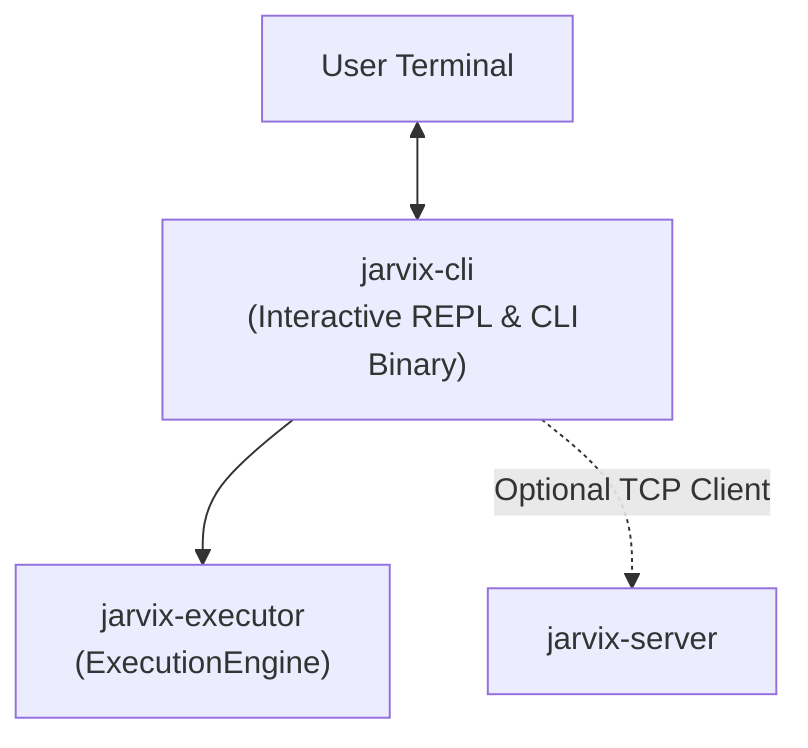

# `jarvix-cli`

## 1. Responsibilities & Purpose

`jarvix-cli` is the interactive command-line interface (REPL) and binary entry point for JavixDB.

It exists to:
- Provide an immediate interactive SQL prompt (`jarvix=# `) with line editing and history.
- Support both **embedded in-process execution mode** (launching directly without needing a background daemon) and **remote client mode** over TCP.
- Render query results in formatted ASCII tables.
- Display timing information and query execution statistics.

---

## 2. File Organization

| File | Purpose |
|---|---|
| `src/main.rs` | CLI application entry point: REPL loop, embedded engine initialization, command dispatch, ASCII table formatting, and meta-commands (`\q`, `\h`, `\d`). |

---

## 3. Subsystem Interactions & Dependencies



- **Depends On**: `jarvix-common`, `jarvix-storage`, `jarvix-buffer`, `jarvix-wal`, `jarvix-txn`, `jarvix-catalog`, `jarvix-executor`, `jarvix-server`, `rustyline`.
- **Depended On By**: End users and administrative scripts.

---

## 4. Rust Learning for Database Engineers

### 4.1 Building a REPL with `rustyline`
```rust
use rustyline::DefaultEditor;

let mut rl = DefaultEditor::new()?;
loop {
    let readline = rl.readline("jarvix=# ");
    match readline {
        Ok(line) => {
            let _ = rl.add_history_entry(line.as_str());
            // Process SQL statement...
        }
        Err(ReadlineError::Interrupted | ReadlineError::Eof) => {
            println!("Goodbye!");
            break;
        }
        Err(err) => {
            eprintln!("Error: {:?}", err);
            break;
        }
    }
}
```
- `rustyline` provides GNU Readline-style terminal editing, arrow key navigation, and persistent history.
- Handling `ReadlineError::Interrupted` (Ctrl+C) and `ReadlineError::Eof` (Ctrl+D) ensures standard Unix/Windows terminal behavior.

### 4.2 Formatting Query Results with ASCII Borders
The CLI inspects `ExecutionResult::Select`:
```rust
pub fn print_table(schema: &Schema, batches: &[RecordBatch]) {
    // Print column headers
    // Print separator line
    // Iterate over rows and format column values
    // Print total row count and elapsed time
}
```
Provides human-readable output matching standard PostgreSQL `psql` format.
