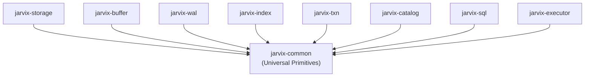

# `jarvix-common`

## 1. Responsibilities & Purpose

`jarvix-common` is the foundational root crate of the JavixDB workspace. It provides the universal primitive types, memory constants, error representations, tuple models, and schema definitions utilized by every single subsystem in the database.

It exists to:
- Establish a single source of truth for global constants (e.g. 8 KB page size, invalid identifiers).
- Standardize the error model (`JarvixError`, `Result<T>`).
- Define core scalar values (`Value::Integer`, `Value::Varchar`, `Value::Boolean`) and rows (`Tuple`).
- Prevent cyclic dependencies between higher-level database subsystems.

---

## 2. File Organization

| File | Purpose |
|---|---|
| `src/constants.rs` | Global database engine constants (`PAGE_SIZE = 8192`, `INVALID_PAGE_ID`, `INVALID_LSN`, `INVALID_TXN_ID`). |
| `src/error.rs` | Unified error enum `JarvixError` using `thiserror` and standard type alias `pub type Result<T> = std::result::Result<T, JarvixError>`. |
| `src/types.rs` | Type aliases for database entity IDs (`PageId`, `SlotId`, `TxnId`, `Lsn`, `Oid`), record addressing (`RecordId`), and the `Value` enum. |
| `src/schema.rs` | Relational table schema representation: `Column` (name, data type, nullability) and `Schema`. |
| `src/tuple.rs` | In-memory row representation: `Tuple` wrapping `Vec<Value>` with serialization methods. |
| `src/lib.rs` | Module re-exports exposing common primitives. |

---

## 3. Subsystem Interactions & Dependencies



- **Depends On**: None (only standard library + `thiserror`).
- **Depended On By**: All 13 other crates in the JavixDB workspace.

---

## 4. Rust Learning for Database Engineers

### 4.1 Structs Explained
```rust
#[derive(Debug, Clone, Copy, PartialEq, Eq, Hash)]
pub struct RecordId {
    pub page_id: PageId,
    pub slot_id: SlotId,
}
```
- **What it represents**: A permanent physical pointer to a specific row in the database.
- **Why it is needed**: Secondary B+Tree indexes map search keys directly to a `RecordId`.
- **Field types**: `page_id: u32` (identifies the 8 KB page), `slot_id: u16` (identifies the slot within that page). Stored as `Copy` for zero-allocation passing.

### 4.2 Enums & Pattern Matching: `Value`
```rust
#[derive(Debug, Clone, PartialEq, PartialOrd)]
pub enum Value {
    Null,
    Integer(i64),
    Varchar(String),
    Boolean(bool),
}
```
- **Why an enum?** Relational databases are strongly-typed, but a table column can hold different types dynamically across rows.
- **Pattern matching**:
```rust
match value {
    Value::Integer(n) => println!("Int: {}", n),
    Value::Varchar(s) => println!("String: {}", s),
    Value::Boolean(b) => println!("Bool: {}", b),
    Value::Null => println!("NULL"),
}
```
The Rust compiler ensures every branch is handled. If a new type is added (e.g. `Timestamp`), the code will not compile until all match expressions are updated!

### 4.3 Error Handling & The `?` Operator
```rust
pub type Result<T> = std::result::Result<T, JarvixError>;
```
Whenever a function might fail (e.g. invalid page read, duplicate table), it returns `Result<T>`.
The `?` operator unwraps the value if `Ok(T)`, or immediately returns early from the calling function if `Err(JarvixError)`.
