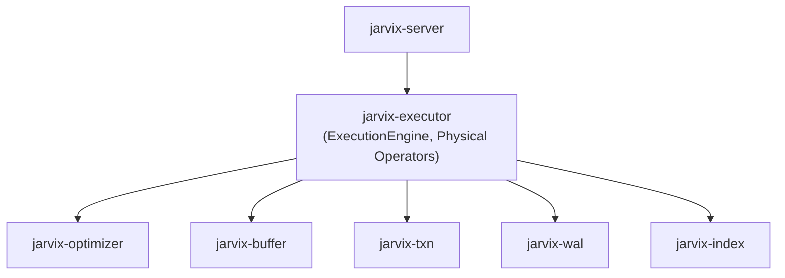

# `jarvix-executor`

## 1. Responsibilities & Purpose

`jarvix-executor` turns optimized query plans into running physical operators, executing queries against the storage and buffer pool engines and producing result sets.

It exists to:
- Implement a Vectorized Volcano iterator model (`Executor` trait with `init()` and `next() -> Option<RecordBatch>`).
- Execute DML statements (`InsertExecutor`, `UpdateExecutor`, `DeleteExecutor`).
- Execute query scans (`SeqScanExecutor`, `IndexScanExecutor`).
- Apply relational transforms (`ProjectionExecutor`, `LimitExecutor`).
- Provide the top-level `ExecutionEngine` coordinating DDL, transactions, and query plans.

---

## 2. File Organization

| File | Purpose |
|---|---|
| `src/batch.rs` | `RecordBatch`: Vectorized column data container for batch-at-a-time execution. |
| `src/context.rs` | `ExecutionContext`: Encapsulates transaction state, buffer pool, catalog, WAL, and lock managers. |
| `src/eval.rs` | Vectorized scalar expression evaluator. |
| `src/executors/mod.rs` | `Executor` trait definition and module exports. |
| `src/executors/seq_scan.rs` | Sequential table scan iterating through slotted pages with MVCC visibility. |
| `src/executors/index_scan.rs` | Point and range scan over B+Tree leaf pages. |
| `src/executors/insert.rs` | Tuple serialization, slotted page insertion, index maintenance, and WAL logging. |
| `src/executors/update.rs` | In-place tuple mutation, undo log recording, and index synchronization. |
| `src/executors/delete.rs` | Slotted page slot deactivation (`DEAD` flag) and undo log recording. |
| `src/executors/projection.rs` | Column projection and expression transformation. |
| `src/executors/limit.rs` | Row count limitation and offset skipping. |
| `src/executors/ddl.rs` | Execution of `CREATE TABLE`, `CREATE INDEX`, `DROP TABLE`. |
| `src/engine.rs` | `ExecutionEngine`: Main entry point binding SQL strings, planning, and execution. |
| `src/lib.rs` | Crate root exposing the engine and executor types. |

---

## 3. Subsystem Interactions & Dependencies



- **Depends On**: `jarvix-common`, `jarvix-storage`, `jarvix-buffer`, `jarvix-index`, `jarvix-wal`, `jarvix-txn`, `jarvix-catalog`, `jarvix-sql`, `jarvix-analyzer`, `jarvix-optimizer`.
- **Depended On By**: `jarvix-server`, `jarvix-cli`.

---

## 4. Rust Learning for Database Engineers

### 4.1 Trait Objects & Dynamic Dispatch (`Box<dyn Executor>`)
```rust
pub trait Executor: Send {
    fn init(&mut self) -> Result<()>;
    fn next(&mut self) -> Result<Option<RecordBatch>>;
    fn schema(&self) -> &Schema;
}
```
- In query engines, operators form an arbitrary tree at runtime (e.g. `ProjectionExecutor` wraps `LimitExecutor` which wraps `SeqScanExecutor`).
- Because the exact combination is only known at runtime, child executors are stored as trait objects: `Box<dyn Executor>`.
- `Send` ensures the query executor tree can be safely passed to worker threads.

### 4.2 Vectorized Batch Processing
Rather than returning one scalar tuple per function call, `next()` returns `RecordBatch` holding up to 1024 tuples. This amortizes dynamic dispatch overhead and significantly boosts cache locality.
