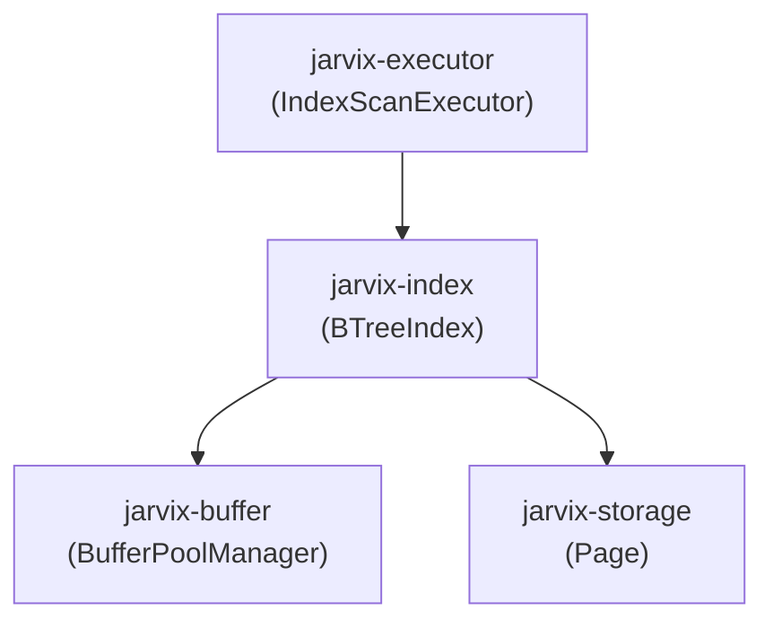

# `jarvix-index`

## 1. Responsibilities & Purpose

`jarvix-index` implements a disk-backed, concurrent B+Tree index for fast key lookups ($O(\log N)$) and horizontal sequential range scans.

It exists to:
- Map search keys (`i64`) to storage row pointers (`RecordId` = `PageId` + `SlotId`).
- Provide B+Tree leaf and internal node layouts conforming to standard 8 KB pages.
- Handle node splitting, key promotion, and root growth during insertions.
- Support bidirectional leaf scans via `next_page_id` and `prev_page_id` sibling pointers.

---

## 2. File Organization

| File | Purpose |
|---|---|
| `src/node_header.rs` | `BTreeNodeHeader`: 16-byte index node metadata layout (node type, size, max_size, parent, next/prev pointers). |
| `src/internal_page.rs` | `BTreeInternalPage`: Routing keys and child `PageId` array management, binary search, and child splits. |
| `src/leaf_page.rs` | `BTreeLeafPage`: Key-value storage (`(i64, RecordId)`), leaf binary search, and half-page splits. |
| `src/btree.rs` | `BTreeIndex`: High-level B+Tree coordinator implementing `search()`, `scan_range()`, `insert()`, and parent tree balancing. |
| `src/lib.rs` | Crate root exposing the B+Tree index and node types. |

---

## 3. Subsystem Interactions & Dependencies



- **Depends On**: `jarvix-common`, `jarvix-storage`, `jarvix-buffer`, `byteorder`.
- **Depended On By**: `jarvix-executor`, `jarvix-server`.

---

## 4. Rust Learning for Database Engineers

### 4.1 Stateless Structs as Namespaces
```rust
pub struct BTreeLeafPage;

impl BTreeLeafPage {
    pub fn size(page: &Page) -> u16 { ... }
    pub fn key_at(page: &Page, idx: usize) -> i64 { ... }
    pub fn insert(page: &mut Page, key: i64, rid: RecordId) -> Result<()> { ... }
}
```
- Notice that `BTreeLeafPage` has no member variables!
- In Rust, empty structs (`struct Foo;`) can be used to group related functions.
- Operating on `&Page` and `&mut Page` directly eliminates the need to allocate intermediate wrapper objects or copy 8 KB memory buffers!

### 4.2 Dynamic Root Pointer Updates with `Arc<RwLock<PageId>>`
```rust
pub struct BTreeIndex {
    root_page_id: Arc<RwLock<PageId>>,
    ...
}
```
- When a root node splits, the root `PageId` changes.
- Storing it inside `Arc<RwLock<PageId>>` allows readers to inspect the root concurrently while allowing the thread performing the split to update the root atomically.
