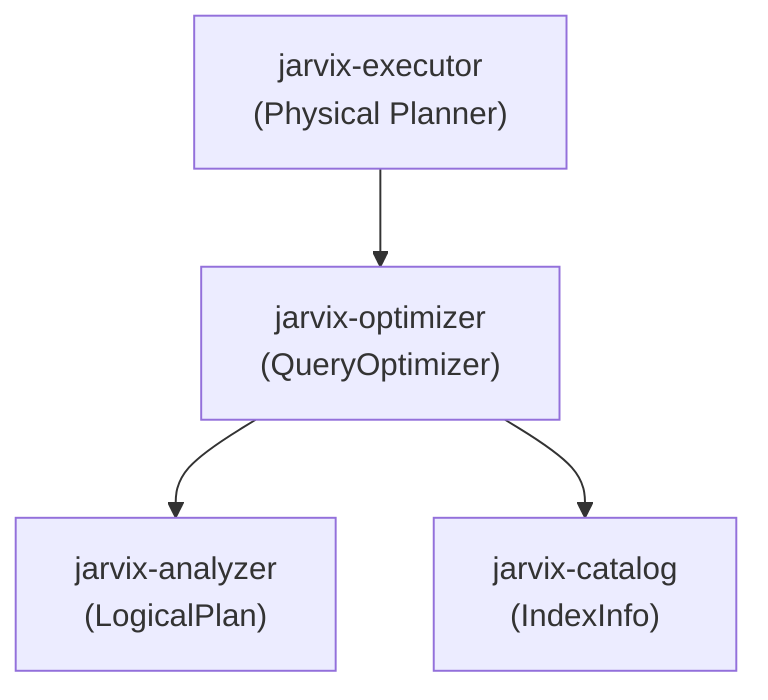

# `jarvix-optimizer`

## 1. Responsibilities & Purpose

`jarvix-optimizer` transforms a semantically validated `LogicalPlan` into an optimized physical or optimized logical execution plan.

It exists to:
- Apply rule-based query rewrite optimizations.
- Perform **Predicate Pushdown**: move filter predicates down the operator tree as close to the storage scan as possible, filtering out non-matching rows early before expensive joins or projections.
- Detect opportunities for **Index Selection**: transform full-table sequential scans (`SeqScan`) into logarithmic B+Tree index lookups (`IndexScan`) when filter predicates match indexed columns.
- Optimize projection lists and push down column pruning.

---

## 2. File Organization

| File | Purpose |
|---|---|
| `src/lib.rs` | `QueryOptimizer`: Applies rewrite rules, predicate pushdown, and index selection logic. |

---

## 3. Subsystem Interactions & Dependencies



- **Depends On**: `jarvix-common`, `jarvix-catalog`, `jarvix-analyzer`.
- **Depended On By**: `jarvix-executor`, `jarvix-server`.

---

## 4. Rust Learning for Database Engineers

### 4.1 Recursive Plan Traversal & Tree Rewriting
```rust
pub fn optimize(&self, plan: LogicalPlan) -> Result<LogicalPlan> {
    match plan {
        LogicalPlan::Projection { exprs, input } => {
            let optimized_input = self.optimize(*input)?;
            Ok(LogicalPlan::Projection {
                exprs,
                input: Box::new(optimized_input),
            })
        }
        ...
    }
}
```
- In Rust, trees of operators are transformed by consuming ownership of the old tree (`plan`) and returning a newly structured tree (`Ok(LogicalPlan)`).
- This functional transformation style ensures no dangling references or accidental mutations exist during optimization passes.

### 4.2 Pattern Matching on Filter Predicates for Index Selection
When optimizing a `LogicalPlan::Filter`:
```rust
if let LogicalPlan::Scan { ref table_name, .. } = *input {
    if let Some(idx_info) = catalog.get_table_indexes(table_name).first() {
        if let Some(lookup_val) = self.extract_index_lookup(&predicate, idx_info.column_idx) {
            // Replace SeqScan with IndexScan!
        }
    }
}
```
Rust's expressive nested pattern matching allows clean, concise AST/Plan analysis.
