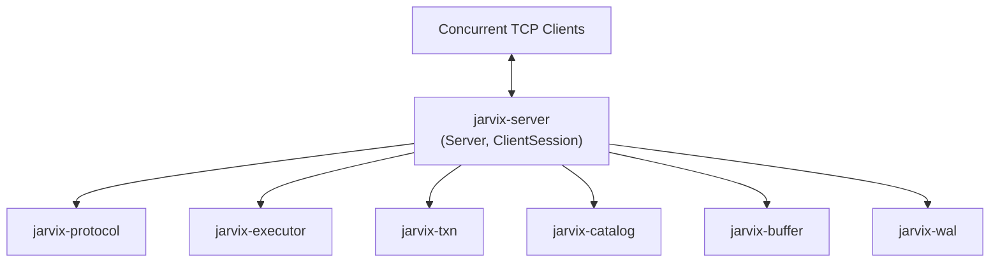

# `jarvix-server`

## 1. Responsibilities & Purpose

`jarvix-server` is the multi-threaded network server daemon for JavixDB.

It exists to:
- Bind to TCP port `5433` and accept incoming client connections.
- Spawn a dedicated `ClientSession` worker thread per connected client.
- Orchestrate shared database components (`BufferPoolManager`, `Catalog`, `TransactionManager`, `WalManager`, `LockManager`).
- Drive the client connection lifecycle from SSL negotiation and authentication to query parsing, execution, and result encoding.

---

## 2. File Organization

| File | Purpose |
|---|---|
| `src/server.rs` | `Server`: Bootstraps disk files, initializes shared managers, binds `TcpListener`, and accepts client connections. |
| `src/session.rs` | `ClientSession`: Worker thread handler executing handshake, parsing queries, dispatching to `ExecutionEngine`, and returning results. |
| `src/lib.rs` | Crate root exposing `Server` and `ClientSession`. |

---

## 3. Subsystem Interactions & Dependencies



- **Depends On**: `jarvix-common`, `jarvix-storage`, `jarvix-buffer`, `jarvix-wal`, `jarvix-txn`, `jarvix-catalog`, `jarvix-sql`, `jarvix-analyzer`, `jarvix-optimizer`, `jarvix-executor`, `jarvix-protocol`.
- **Depended On By**: `jarvix-cli`.

---

## 4. Rust Learning for Database Engineers

### 4.1 Thread-per-Connection with `std::thread::spawn`
```rust
let mut session = ClientSession::new(
    stream,
    bpm.clone(),
    catalog.clone(),
    txn_mgr.clone(),
    wal_mgr.clone(),
    lock_mgr.clone(),
);

std::thread::spawn(move || {
    if let Err(e) = session.run() {
        eprintln!("Session error: {:?}", e);
    }
});
```
- In Rust, `move` transfers ownership of variables captured in the closure into the new thread.
- Cloned `Arc` references ensure that the shared engine state remains valid as long as at least one worker session is running.

### 4.2 Graceful Network Teardown
When a client terminates the connection (`FrontendMessage::Terminate` or socket EOF), the `command_loop` terminates cleanly, dropping `ClientSession` and unpinning any held buffers.
