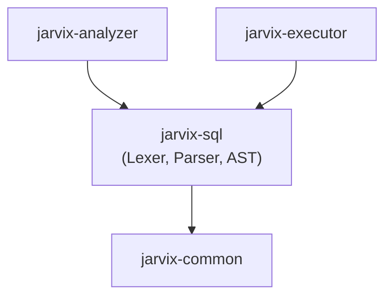

# `jarvix-sql`

## 1. Responsibilities & Purpose

`jarvix-sql` implements the SQL frontend compiler: lexer, tokenizer, recursive descent parser, and Abstract Syntax Tree (AST).

It exists to:
- Tokenize SQL source text into structured tokens (`Token`, `Keyword`, `Literal`, `Symbol`).
- Parse SQL grammar using recursive descent and Pratt parsing for operator precedence.
- Produce an Abstract Syntax Tree (`Statement`, `SelectStatement`, `InsertStatement`, `CreateTableStatement`, `Expr`).

---

## 2. File Organization

| File | Purpose |
|---|---|
| `src/token.rs` | Token enum definitions (`Keyword`, `Ident`, `Integer`, `String`, `Operator`, `Symbol`). |
| `src/lexer.rs` | `Lexer`: Scans raw SQL characters into a token stream with line/column tracking. |
| `src/ast.rs` | Strong typing of SQL AST nodes (`Statement`, `Expr`, `BinaryOp`, `ColumnDef`, `DataType`). |
| `src/parser.rs` | `Parser`: Recursive descent and Pratt expression parser translating tokens into AST. |
| `src/lib.rs` | Crate root exposing the parser and AST types. |

---

## 3. Subsystem Interactions & Dependencies



- **Depends On**: `jarvix-common`.
- **Depended On By**: `jarvix-analyzer`, `jarvix-executor`, `jarvix-server`.

---

## 4. Rust Learning for Database Engineers

### 4.1 Recursive Data Structures with `Box<T>`
```rust
#[derive(Debug, Clone, PartialEq)]
pub enum Expr {
    BinaryOp {
        left: Box<Expr>,
        op: BinaryOperator,
        right: Box<Expr>,
    },
    ...
}
```
- **Why `Box<Expr>`?** In Rust, an enum's size must be known at compile time. An expression can be infinitely nested (`1 + (2 * (3 + 4))`).
- If an enum variant contains itself directly, its size would be infinite!
- Wrapping sub-expressions in `Box<Expr>` places them on the heap with a fixed pointer size (8 bytes on 64-bit systems).

### 4.2 Pratt Parsing for Operator Precedence
The parser assigns binding power to binary operators (`*` has higher binding power than `+`), allowing natural mathematical precedence parsing without complex multi-pass syntax trees.
