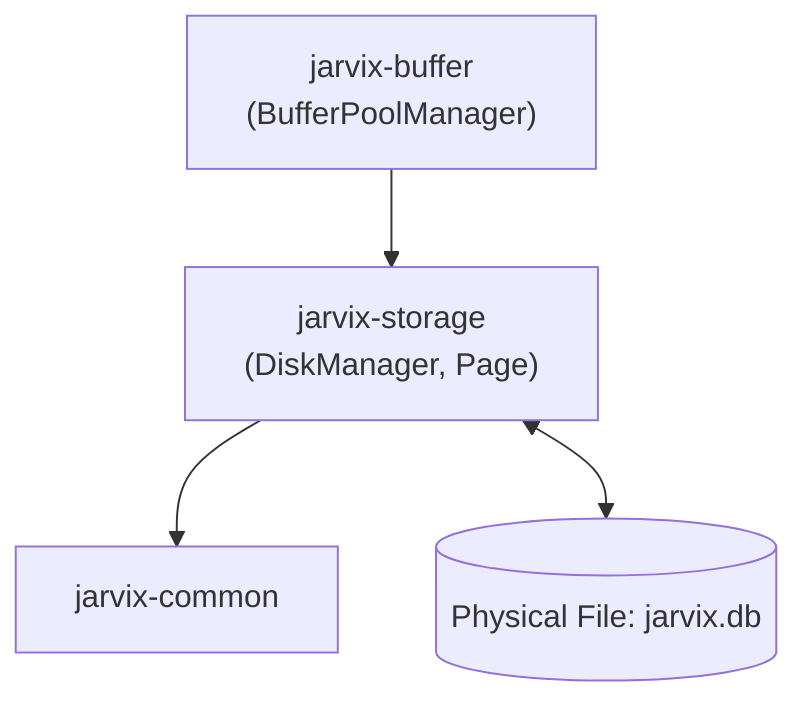

# `jarvix-storage`

## 1. Responsibilities & Purpose

`jarvix-storage` is responsible for low-level physical disk I/O, file header management, and in-page slotted tuple layout.

It exists to:
- Directly read and write 8 KB pages to persistent storage files.
- Manage logical page allocation (`allocate_page()`).
- Implement PostgreSQL-compatible slotted pages (`Page`, `ItemId`, `PageHeaderSize`), handling variable-length tuples and in-place defragmentation.

---

## 2. File Organization

| File | Purpose |
|---|---|
| `src/disk.rs` | `DiskManager`: Thread-safe file reader and writer using `Mutex<File>` and `AtomicU32` for page allocation. |
| `src/page.rs` | `Page`: 8192-byte physical page structure, `ItemId` slot directory, header offsets, tuple insertion, reading, deletion, and in-place `compact()`. |
| `src/lib.rs` | Crate root exposing `DiskManager`, `Page`, `PageType`, `ItemId`, and slot constants. |

---

## 3. Subsystem Interactions & Dependencies



- **Depends On**: `jarvix-common`, `byteorder`, `crc32fast`.
- **Depended On By**: `jarvix-buffer`, `jarvix-index`, `jarvix-executor`, `jarvix-wal`.

---

## 4. Rust Learning for Database Engineers

### 4.1 Structs Explained
```rust
pub struct DiskManager {
    file_path: PathBuf,
    file: Mutex<File>,
    num_pages: AtomicU32,
}
```
- **`file: Mutex<File>`**: Rust's standard `File` struct requires mutable access (`&mut self`) to seek and read. Wrapping it in a `Mutex` makes it thread-safe so multiple threads can share a single `DiskManager`.
- **`num_pages: AtomicU32`**: Allows lock-free page ID allocation via `.fetch_add(1, Ordering::SeqCst)`.

### 4.2 In-Place Page Compaction (`compact`)
```rust
pub fn compact(&mut self) {
    let mut temp = [0u8; PAGE_SIZE];
    // Reorganize active tuples contiguously against upper end of page
    // Reset self.upper and update each active ItemId offset
}
```
- **Why `&mut self`?** In Rust, mutating the page's raw memory requires an exclusive, mutable borrow (`&mut Page`). The compiler guarantees that no other thread is reading this page while it is being compacted.

### 4.3 Safe Memory Alignment
```rust
#[repr(C, align(4096))]
pub struct Page {
    pub data: [u8; PAGE_SIZE],
}
```
- Memory alignment ensures zero-copy Direct I/O transfers with hardware disk controllers that require 4096-byte memory page boundaries.
