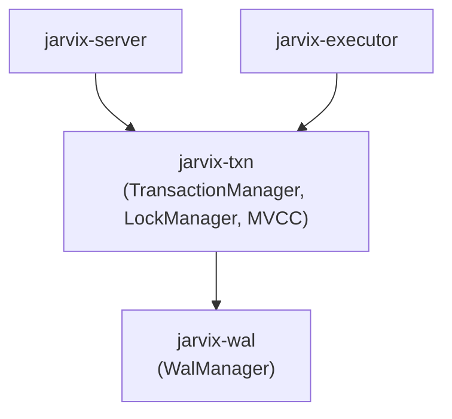

# `jarvix-txn`

## 1. Responsibilities & Purpose

`jarvix-txn` coordinates transactions, enforces ACID properties, manages Multi-Version Concurrency Control (MVCC) snapshots, and prevents race conditions through Strict Two-Phase Locking (SS2PL) and cycle-detection deadlock prevention.

It exists to:
- Coordinate transaction lifecycles (`begin()`, `commit()`, `abort()`).
- Maintain point-in-time snapshot isolation using InnoDB-style `ReadView`s.
- Track undo logs for rolling back aborted transactions.
- Enforce Strict 2PL on tables and rows with cycle-detection deadlock prevention.

---

## 2. File Organization

| File | Purpose |
|---|---|
| `src/transaction_manager.rs` | `TransactionManager` & `Transaction`: Coordinates transaction lifecycles, atomic ID counters, and active transaction maps. |
| `src/mvcc.rs` | `ReadView`, `IsolationLevel`, and row visibility evaluation rules. |
| `src/lock_manager.rs` | `LockManager`: Strict 2PL S/X lock queues and Wait-For Graph (WFG) DFS deadlock detection. |
| `src/undo.rs` | `UndoLogManager`: In-memory storage and replay of before-images for rollback. |
| `src/lib.rs` | Crate root exposing transaction, MVCC, and lock manager primitives. |

---

## 3. Subsystem Interactions & Dependencies



- **Depends On**: `jarvix-common`, `jarvix-storage`, `jarvix-buffer`, `jarvix-wal`.
- **Depended On By**: `jarvix-executor`, `jarvix-server`.

---

## 4. Rust Learning for Database Engineers

### 4.1 Fine-Grained Locking & Deadlock Avoidance in Rust
```rust
pub struct LockManager {
    table: Mutex<HashMap<LockKey, LockRequestQueue>>,
    waits_for: Mutex<HashMap<TxnId, HashSet<TxnId>>>,
    cvar: Condvar,
}
```
- By separating the lock queue (`table`) from the wait-for graph (`waits_for`), lock evaluations do not block graph cycle checks unnecessarily.
- When a thread must wait, `self.cvar.wait(table)` atomically unlocks the table mutex and parks the thread until awakened by `cvar.notify_all()`.

### 4.2 Safe Snapshot Generation with `HashSet`
- A `ReadView` takes a snapshot of `active_txns: HashSet<TxnId>` at transaction creation.
- Rust's ownership guarantees ensure this snapshot is an immutable, isolated value that cannot be corrupted by other threads finishing or starting transactions later.
