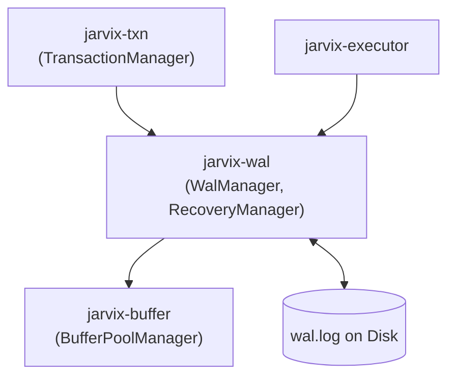

# `jarvix-wal`

## 1. Responsibilities & Purpose

`jarvix-wal` is responsible for transaction durability, Write-Ahead Logging (WAL), and ARIES crash recovery.

It exists to:
- Enforce the Write-Ahead Logging invariant ($\text{page.lsn} \le \text{flushed\_lsn}$).
- Serialize transaction records (`Begin`, `Commit`, `Abort`, `Insert`, `Update`, `Delete`, `Clr`) into append-only log files.
- Coordinate group commits and synchronous file flushes (`fsync`).
- Execute 3-phase ARIES crash recovery (Analysis, Redo, Undo) to restore the database to a consistent state upon reboot.

---

## 2. File Organization

| File | Purpose |
|---|---|
| `src/record.rs` | `LogRecord`: Binary serialization and deserialization of physiological log records and CLRs. |
| `src/manager.rs` | `WalManager`: Thread-safe WAL append buffer, monotonic LSN counter, and disk sync coordinator. |
| `src/recovery.rs` | `RecoveryManager`: Implements ARIES 3-Phase recovery (Analysis, Redo, Undo). |
| `src/lib.rs` | Crate root exposing WAL records, manager, and recovery. |

---

## 3. Subsystem Interactions & Dependencies



- **Depends On**: `jarvix-common`, `jarvix-storage`, `jarvix-buffer`, `byteorder`, `crc32fast`.
- **Depended On By**: `jarvix-txn`, `jarvix-executor`, `jarvix-server`.

---

## 4. Rust Learning for Database Engineers

### 4.1 Enums with Explicit Discriminants (`#[repr(u8)]`)
```rust
#[derive(Debug, Clone, Copy, PartialEq, Eq)]
#[repr(u8)]
pub enum LogRecordType {
    Invalid = 0,
    Begin = 1,
    Commit = 2,
    Abort = 3,
    Insert = 4,
    Update = 5,
    Delete = 6,
    Clr = 7,
}
```
- **Why `#[repr(u8)]`?** Guarantees that in memory and on disk, the enum variant occupies exactly 1 byte.
- Implementing `From<u8>` allows safe translation of binary bytes read from the WAL file into strongly typed enum variants.

### 4.2 Safe Memory Buffers with `Vec<u8>`
- `LogRecord` stores variable-length row states as owned vectors: `before_image: Vec<u8>` and `after_image: Vec<u8>`.
- Rust vectors handle automatic heap reallocation and guarantee proper deallocation when the record is dropped.
