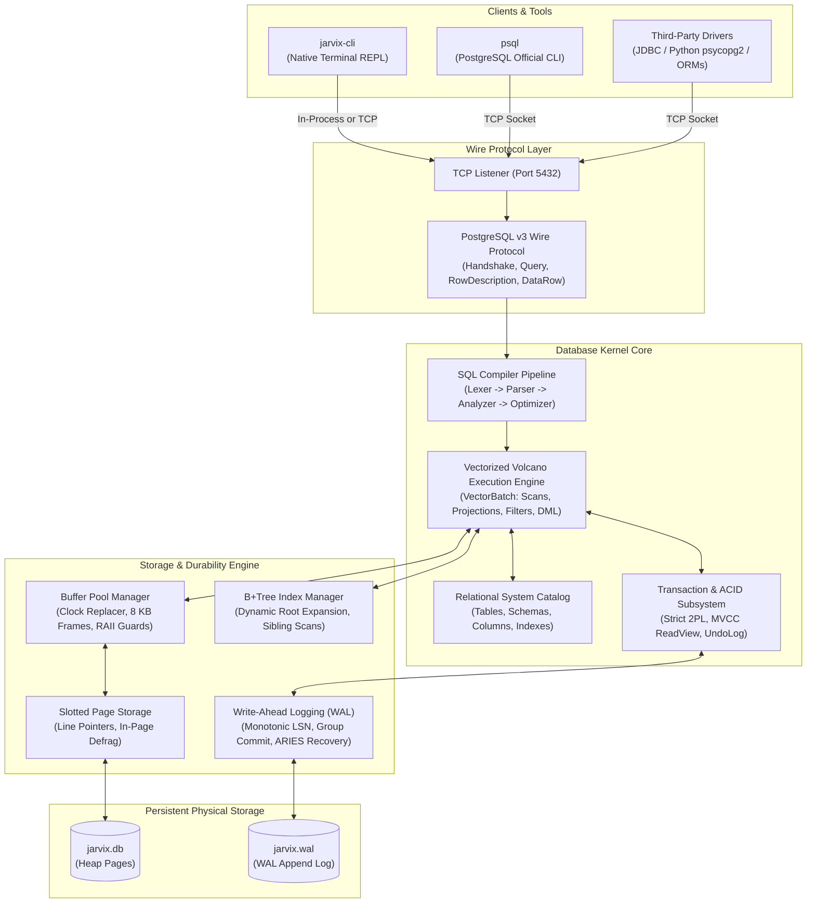

# 00 - System Overview

## 1. What is JavixDB?

**JavixDB** is an independent, persistent, concurrent, ACID-compliant relational database management system (RDBMS) written entirely from scratch in modern Rust. It is not an in-memory toy or a simple SQL parser—it is an engine featuring:

- Disk-backed 8 KB slotted pages with line pointer arrays.
- Clock second-chance buffer pool manager with atomic frame pins and RAII guards.
- Concurrent disk-backed B+Tree indexing.
- ARIES-compliant Write-Ahead Logging (WAL) with group commit and crash recovery.
- Strict Two-Phase Locking (2PL) with Wait-For Graph (WFG) cycle detection.
- Multi-Version Concurrency Control (MVCC) with ReadViews and Undo logs.
- Recursive-descent SQL parser, semantic analyzer, catalog binder, and query optimizer.
- Vectorized Volcano execution engine processing batches of up to 1024 tuples.
- PostgreSQL v3 wire protocol compatibility (usable with `psql`, JDBC, Python drivers, and `jarvix-cli`).



---

## 2. PostgreSQL vs. MySQL/InnoDB Synthesis

JavixDB reverse-engineers and synthesizes the best design choices from both major open-source database engines:

| Dimension | PostgreSQL Architecture | MySQL / InnoDB Architecture | JavixDB Synthesis Choice | Why? |
| :--- | :--- | :--- | :--- | :--- |
| **Process Model** | Multi-process (`fork()` per client, shared memory segment) | Multi-threaded (Thread-per-connection worker pool) | **Multi-threaded worker model** in Rust | Rust provides compile-time data-race freedom (`Send` and `Sync`). Multi-threading avoids heavyweight OS process forks and costly IPC. |
| **MVCC Implementation** | In-place multi-versioning in heap pages (causes table bloat and requires autovacuum) | Rollback segment with Undo Logs; heap always contains current row | **InnoDB-style Undo Logs** | Keeps heap pages compact and eliminates table-wide vacuum freezes while retaining MVCC historical snapshots. |
| **Page Format** | Slotted page layout (24-byte header, line pointer array, upper/lower bounds) | Slotted page with Infimum/Supremum boundary records | **PostgreSQL Slotted Page Layout** | Clean 8 KB alignment with offset line pointers (`ItemId`), variable-length tuple support, and simple in-page compaction. |
| **Storage Architecture** | Heap files + Secondary B-Trees | Clustered index (B+Tree owns the table data) | **Slotted Heap Pages + Secondary B+Trees** | Simplifies table partitioning, secondary indexing, and out-of-order bulk insertions. |
| **WAL & Recovery** | ARIES-style write-ahead logging with redo checkpoints | Doublewrite buffer + redo log + undo log | **ARIES WAL with Group Commit** | Industry-standard reliability: Analysis pass, Redo pass (roll-forward), and Undo pass (with Compensation Log Records). |

---

## 3. Rust Learning Concepts for Beginners

### A. Ownership and Move Semantics
In languages like C or C++, memory management is manual (`malloc` and `free`). In Java or Go, a Garbage Collector (GC) periodically pauses the program to reclaim unreferenced memory.

Rust uses **Ownership**:
1. Every value in Rust has an **owner** (a variable).
2. There can only be **one owner at a time**.
3. When the owner goes out of scope, the memory is automatically freed (**RAII**).

```rust
// Example from JavixDB:
let tuple = Tuple::new(vec![Value::Integer(42)]);
// 'tuple' owns the vector and its memory on the heap.

let batch = VectorBatch::with_tuples(vec![tuple]);
// 'tuple' was MOVED into 'batch'. You can no longer access 'tuple' directly.
```

### B. Borrowing: Shared References (`&T`) vs. Mutable References (`&mut T`)
Instead of giving away ownership, you can **borrow** a reference:
- `&T` (Shared Reference): You can have **unlimited** shared references, but cannot modify the data.
- `&mut T` (Mutable Reference): You can have **only one** mutable reference at any given time, and NO shared references can exist simultaneously.

This prevents data races at compile time!

---

## 4. End-to-End Query Lifecycle

1. **Client** issues `SELECT id, name FROM users WHERE id = 101;` over TCP or CLI.
2. **`jarvix-protocol`** decodes the query packet and passes the string to **`ClientSession`**.
3. **`jarvix-sql`** converts the string into tokens (`Lexer`) and an AST (`Parser`).
4. **`jarvix-analyzer`** checks table schema in `Catalog` and type-checks columns.
5. **`jarvix-optimizer`** detects index `idx_users_id` on column `id`, pushing down the filter and transforming `SeqScan` into `IndexScan`.
6. **`jarvix-executor`** executes the plan:
   - Acquires Shared 2PL lock on the table.
   - Searches B+Tree index for key `101` -> returns `RecordId(page_id=2, slot_id=0)`.
   - Fetches page 2 via `BufferPoolManager` (pinned in memory).
   - Reads tuple bytes from slot 0 and evaluates projections.
7. Result rows are formatted into PostgreSQL wire `DataRow` packets and returned to the client.
