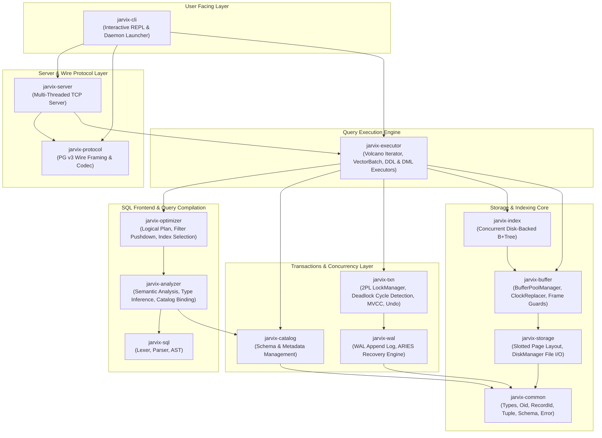

# 01 - Workspace Architecture

## 1. Why a Cargo Workspace?

A production-grade relational database consists of multiple distinct, reusable domains:
- Low-level byte layouts and physical page managers should **never** know about SQL parsing.
- The transaction manager should handle locking without knowing how queries are parsed or formatted over the network.
- The wire protocol decoder should be testable independently without spinning up a live disk manager.

To enforce strict boundary separation, JavixDB is split into a **Cargo Workspace** consisting of 14 independent crates.



---

## 2. Workspace Layout

The root `Cargo.toml` defines the workspace members and shares version and dependency configurations across all sub-crates:

```
jarvix/
├── Cargo.toml                  # Workspace manifest
├── docs/                       # Architectural specs and Mermaid diagrams
├── crates/
│   ├── jarvix-common/          # Fundamental data types, IDs, Value, Schema, Tuple
│   ├── jarvix-storage/         # 8 KB slotted page & physical file manager
│   ├── jarvix-buffer/          # Buffer pool, Clock eviction replacer, RAII frame guards
│   ├── jarvix-index/           # Concurrent disk-backed B+Tree engine
│   ├── jarvix-wal/             # Write-ahead logging & ARIES crash recovery
│   ├── jarvix-txn/             # 2PL locking, deadlock cycle detection, MVCC ReadView, undo
│   ├── jarvix-catalog/         # Relational schema catalog & table/index metadata
│   ├── jarvix-sql/             # Handcrafted lexer & recursive-descent SQL parser
│   ├── jarvix-analyzer/        # Semantic analysis & catalog schema binding
│   ├── jarvix-optimizer/       # Rule-based optimizer (filter pushdown, index selection)
│   ├── jarvix-executor/        # Vectorized Volcano execution engine (VectorBatch)
│   ├── jarvix-protocol/        # PostgreSQL v3 wire protocol framing and codec
│   ├── jarvix-server/          # Multi-threaded TCP network server daemon
│   └── jarvix-cli/             # Interactive terminal REPL & server launcher binary
```

---

## 3. Rust Learning Concepts: Modules & Visibility

In Rust:
- **`mod` keyword**: Defines a module (a unit of code organization within a crate).
- **`pub` keyword**: By default, everything in Rust (structs, functions, enums, fields) is **private** to its enclosing module. Adding `pub` makes it visible to outer modules and other crates.
- **`pub(crate)`**: Makes an item visible anywhere within the current crate, but not to external crates that depend on it.

### Example in JavixDB:
In `crates/jarvix-buffer/src/manager.rs`:
```rust
// 'pub(crate)' allows BufferPoolManager to inspect the inner state,
// but prevents users outside 'jarvix-buffer' from tampering with frames directly!
pub(crate) struct BufferPoolInner {
    pub(crate) pool_size: usize,
    pub(crate) frames: Vec<BufferFrame>,
    pub(crate) page_table: Mutex<HashMap<PageId, FrameId>>,
    pub(crate) replacer: Mutex<ClockReplacer>,
    pub(crate) free_list: Mutex<Vec<FrameId>>,
    pub(crate) disk_manager: Arc<DiskManager>,
}

// 'pub' makes BufferPoolManager the clean, safe public API of this crate:
#[derive(Clone)]
pub struct BufferPoolManager {
    inner: Arc<BufferPoolInner>,
}
```

---

## 4. How to Build & Test the Workspace

```bash
# Compile all 14 crates
cargo build --workspace

# Run tests across all 14 crates
cargo test --workspace
```
