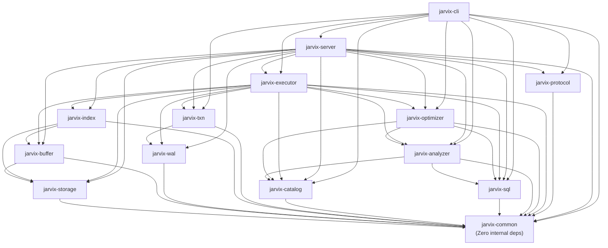

# 02 - Module Dependencies

## 1. Dependency Graph (DAG)

A critical architectural principle of JavixDB is **Zero Circular Dependencies**. The dependency graph forms a strict Directed Acyclic Graph (DAG), ensuring that crates compile cleanly in parallel and can be reasoned about hierarchically.



---

## 2. Dependency Matrix

| Crate | Direct Workspace Dependencies | Why Needed? |
| :--- | :--- | :--- |
| **`jarvix-common`** | None | Base crate providing types, IDs (`PageId`, `TxnId`, `Lsn`), and error handling. |
| **`jarvix-storage`** | `jarvix-common` | Uses `PAGE_SIZE`, `PageId`, and `JarvixError`. |
| **`jarvix-buffer`** | `jarvix-common`, `jarvix-storage` | Caches `Page` frames allocated via `DiskManager`. |
| **`jarvix-wal`** | `jarvix-common` | Writes binary `LogRecord` structures with `Lsn` offsets. |
| **`jarvix-index`** | `jarvix-common`, `jarvix-storage`, `jarvix-buffer` | Reads and writes B+Tree nodes as physical pages in `BufferPoolManager`. |
| **`jarvix-txn`** | `jarvix-common`, `jarvix-wal` | Logs `Begin`, `Commit`, `Abort` records into `WalManager`. |
| **`jarvix-catalog`** | `jarvix-common` | Stores table and index metadata mapped to `Oid` and `PageId`. |
| **`jarvix-sql`** | `jarvix-common` | Parses SQL tokens into AST nodes holding `Value` and `DataType`. |
| **`jarvix-analyzer`** | `jarvix-common`, `jarvix-sql`, `jarvix-catalog` | Binds AST table names and column names to catalog schema definitions. |
| **`jarvix-optimizer`** | `jarvix-common`, `jarvix-catalog`, `jarvix-analyzer`, `jarvix-sql` | Optimizes `BoundStatement` into `LogicalPlan` using index availability. |
| **`jarvix-executor`** | `jarvix-common`, `jarvix-storage`, `jarvix-buffer`, `jarvix-wal`, `jarvix-index`, `jarvix-txn`, `jarvix-catalog`, `jarvix-sql`, `jarvix-analyzer`, `jarvix-optimizer` | Coordinates the physical execution tree with transactions, buffer pool, and indexes. |
| **`jarvix-protocol`** | `jarvix-common` | Encodes and decodes PostgreSQL wire protocol messages. |
| **`jarvix-server`** | `jarvix-common`, `jarvix-storage`, `jarvix-buffer`, `jarvix-wal`, `jarvix-index`, `jarvix-txn`, `jarvix-catalog`, `jarvix-sql`, `jarvix-analyzer`, `jarvix-optimizer`, `jarvix-executor`, `jarvix-protocol` | Boots the database engine and accepts TCP client connections. |
| **`jarvix-cli`** | `jarvix-common`, `jarvix-protocol`, `jarvix-server`, `jarvix-catalog`, `jarvix-sql`, `jarvix-analyzer`, `jarvix-optimizer`, `jarvix-executor`, `jarvix-txn` | Implements both client REPL and in-process embedded engine execution. |

---

## 3. Rust Learning Concepts: Trait Objects (`Box<dyn Trait>`)

When crate `jarvix-executor` builds execution pipelines, child executors can be of different types:
- `SeqScanExecutor`
- `IndexScanExecutor`
- `ProjectionExecutor`
- `LimitExecutor`

In Rust, all elements in a struct or function call must have a size known at compile time (`Sized`). Since `SeqScanExecutor` and `IndexScanExecutor` have different memory sizes, we cannot write:
```rust
// ILLEGAL: Compiler doesn't know how many bytes this trait occupies!
struct ProjectionExecutor {
    child: dyn Executor,
}
```

Instead, we use a **Trait Object** on the heap:
```rust
pub struct ProjectionExecutor {
    projection_indices: Vec<usize>,
    child: Box<dyn Executor>, // Fat pointer (data pointer + vtable pointer)
    schema: Schema,
}
```

### Why `Box<dyn Executor>`?
- `Box<T>` allocates the child executor on the heap and stores a pointer on the stack.
- The pointer is always 16 bytes on 64-bit systems (8 bytes for data pointer, 8 bytes for vtable).
- This enables **dynamic dispatch**: calling `self.child.next()` looks up the method in the vtable at runtime, allowing arbitrary executor trees to be nested cleanly!
