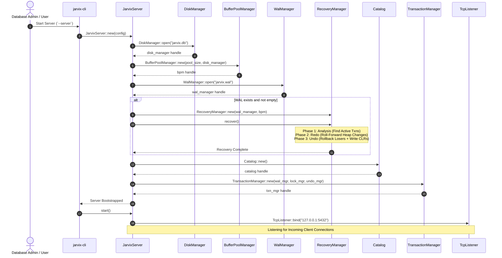

# 03 - Server Architecture

## 1. Subsystem Responsibilities

The server layer (`jarvix-server`) is the orchestration hub of JavixDB. It is responsible for:
1. Bootstrapping persistent storage files (`jarvix.db` and `jarvix.wal`).
2. Performing automatic ARIES crash recovery if the database crashed during a prior run.
3. Initializing shared kernel subsystems: `BufferPoolManager`, `Catalog`, `TransactionManager`, `WalManager`, and `LockManager`.
4. Binding a multi-threaded TCP listener on port 5432.
5. Spawning dedicated connection worker threads (`ClientSession`) for each connected client.



---

## 2. Shared Kernel State Struct

```rust
pub struct JarvixServer {
    config: ServerConfig,
    bpm: BufferPoolManager,
    catalog: Arc<RwLock<Catalog>>,
    txn_mgr: Arc<TransactionManager>,
    wal_mgr: Arc<WalManager>,
    lock_mgr: Arc<LockManager>,
    is_running: Arc<AtomicBool>,
}
```

---

## 3. Rust Learning Concepts: Thread Safety (`Arc`, `RwLock`, `Mutex`, `Send`, `Sync`)

### A. What is `Arc<T>`?
- `Arc` stands for **Atomic Reference Counted** smart pointer.
- When multiple threads need to share the same instance of `Catalog` or `TransactionManager`, cloning an `Arc` increments an atomic counter.
- When all threads drop their `Arc` handles, the reference count drops to 0 and the object is automatically freed from the heap.

### B. What is `RwLock<T>`?
- `RwLock` stands for **Reader-Writer Lock**.
- It allows **multiple threads to read simultaneously** (`read()`), but requires **exclusive access to write** (`write()`).
- In JavixDB, `Catalog` is wrapped in `Arc<RwLock<Catalog>>` because 99% of queries only read metadata (schema lookup), while DDL (`CREATE TABLE`) takes a write lock.

### C. What are `Send` and `Sync`?
- `Send`: Indicates that ownership of a type can be transferred across thread boundaries.
- `Sync`: Indicates that it is safe to share references (`&T`) between multiple threads.
- If a type is `Sync`, then `Arc<T>` is `Send`. The Rust compiler automatically verifies this at compile time!

---

## 4. Connection Dispatching Loop

```rust
pub fn start(&self) -> Result<()> {
    let addr = format!("{}:{}", self.config.host, self.config.port);
    let listener = TcpListener::bind(&addr)?;
    self.is_running.store(true, Ordering::SeqCst);

    while self.is_running.load(Ordering::Acquire) {
        match listener.accept() {
            Ok((stream, _peer_addr)) => {
                let bpm = self.bpm.clone();
                let catalog = Arc::clone(&self.catalog);
                let txn_mgr = Arc::clone(&self.txn_mgr);
                let wal_mgr = Arc::clone(&self.wal_mgr);
                let lock_mgr = Arc::clone(&self.lock_mgr);

                // Spawn a dedicated thread for each connected client:
                thread::spawn(move || {
                    let mut session = ClientSession::new(
                        stream, bpm, catalog, txn_mgr, wal_mgr, lock_mgr,
                    );
                    let _ = session.run();
                });
            }
            Err(e) => {
                if !self.is_running.load(Ordering::Acquire) {
                    break;
                }
                eprintln!("Accept error: {}", e);
            }
        }
    }
    Ok(())
}
```
