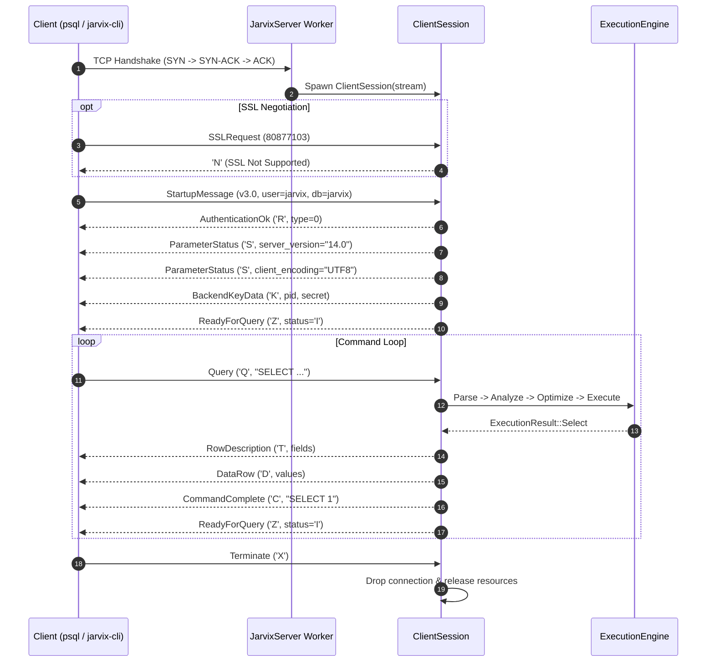

# 04 - Network Architecture & Wire Protocol

## 1. PostgreSQL v3 Wire Protocol Compatibility

Instead of inventing a proprietary wire format, JavixDB implements the official **PostgreSQL v3.0 Wire Protocol**. This provides major operational advantages:
- Developers can use standard PostgreSQL client libraries in any language (`psql`, JDBC, Python `psycopg2`, Node.js `pg`, Go `pgx`).
- Standard monitoring tools and connection poolers can interface directly with JavixDB.



---

## 2. Protocol Frame Format

Every message exchanged after the initial startup handshake begins with a 1-byte identifier tag, followed by a 4-byte network-order (Big-Endian) length:

```
+-----------+--------------------+-----------------------------+
| Tag (1 B) | Length: N (4 B BE) | Payload Body (N - 4 Bytes)  |
+-----------+--------------------+-----------------------------+
```

### Key Message Types:
| Tag | Name | Direction | Payload Description |
| :--- | :--- | :--- | :--- |
| `Q` | `Query` | Frontend -> Backend | Null-terminated SQL command string. |
| `X` | `Terminate` | Frontend -> Backend | Connection close indicator (len = 4). |
| `R` | `AuthenticationOk` | Backend -> Frontend | 4-byte auth code (`0` = success). |
| `S` | `ParameterStatus` | Backend -> Frontend | Null-terminated key and value strings. |
| `K` | `BackendKeyData` | Backend -> Frontend | 4-byte Process ID + 4-byte Secret Key. |
| `T` | `RowDescription` | Backend -> Frontend | Column names, OIDs, type sizes, and format codes. |
| `D` | `DataRow` | Backend -> Frontend | Column count + per-column byte length and raw data. |
| `C` | `CommandComplete` | Backend -> Frontend | Tag string (e.g. `SELECT 2`, `INSERT 0 3`). |
| `Z` | `ReadyForQuery` | Backend -> Frontend | 1-byte transaction status (`'I'` = Idle, `'T'` = In Txn). |
| `E` | `ErrorResponse` | Backend -> Frontend | Error fields (Severity, SQLSTATE, Message). |

---

## 3. Rust Learning Concepts: Enums with Data & Byte Manipulation

In C, an `enum` is simply a named integer. In Rust, an `enum` is an **Algebraic Data Type (tagged union)** that can carry rich structured data:

```rust
// From jarvix-protocol/src/backend.rs:
#[derive(Debug, Clone, PartialEq)]
pub enum BackendMessage {
    AuthenticationOk,
    ParameterStatus {
        name: String,
        value: String,
    },
    BackendKeyData {
        process_id: u32,
        secret_key: u32,
    },
    ReadyForQuery(char),
    RowDescription(Vec<FieldDescription>),
    DataRow(Vec<Option<Vec<u8>>>),
    CommandComplete(String),
    ErrorResponse {
        severity: String,
        code: String,
        message: String,
    },
}
```

### Pattern Matching (`match`)
Rust requires exhaustive matching. If you add a new message variant, the compiler ensures you handle it everywhere:

```rust
match msg {
    FrontendMessage::Query(sql) => {
        self.execute_query(&sql)?;
    }
    FrontendMessage::Terminate => {
        break;
    }
    _ => {
        self.send_message(BackendMessage::ReadyForQuery('I'))?;
    }
}
```
