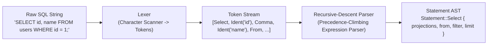

# 05 - SQL Processing: Lexer, Parser & AST

## 1. Overview

The SQL frontend (`jarvix-sql`) converts human-readable SQL strings into structured, type-safe Abstract Syntax Tree (AST) nodes. JavixDB implements a handwritten **Lexer** and **Recursive-Descent Parser**, avoiding fragile third-party parser generators.



---

## 2. Lexical Analysis (`Lexer`)

The Lexer scans characters sequentially and categorizes them into `Token` variants:
- **Keywords**: `SELECT`, `FROM`, `WHERE`, `INSERT`, `INTO`, `VALUES`, `UPDATE`, `SET`, `DELETE`, `CREATE`, `TABLE`, `INDEX`, `BEGIN`, `COMMIT`, `ROLLBACK`.
- **Identifiers**: Table names, column names (`users`, `salary`).
- **Literals**: Integer (`42`), String (`'Alice'`), Boolean (`TRUE`, `FALSE`), `NULL`.
- **Operators & Symbols**: `*`, `,`, `;`, `(`, `)`, `=`, `!=`, `<`, `<=`, `>`, `>=`, `+`, `-`.

---

## 3. Abstract Syntax Tree (`Statement` & `Expr`)

```rust
// In jarvix-sql/src/ast.rs:
#[derive(Debug, Clone, PartialEq)]
pub enum Statement {
    CreateTable {
        name: String,
        columns: Vec<ColumnDef>,
        if_not_exists: bool,
    },
    CreateIndex {
        name: String,
        table: String,
        column: String,
        unique: bool,
    },
    Select {
        projections: Vec<SelectItem>,
        from: String,
        filter: Option<Expr>,
        limit: Option<usize>,
    },
    Insert {
        table: String,
        columns: Option<Vec<String>>,
        values: Vec<Vec<Expr>>,
    },
    Update {
        table: String,
        assignments: Vec<(String, Expr)>,
        filter: Option<Expr>,
    },
    Delete {
        table: String,
        filter: Option<Expr>,
    },
}
```

Expressions are recursive trees:
```rust
#[derive(Debug, Clone, PartialEq)]
pub enum Expr {
    Literal(Value),
    Column(String),
    BinaryOp {
        left: Box<Expr>,
        op: BinaryOperator,
        right: Box<Expr>,
    },
    UnaryOp {
        op: UnaryOperator,
        expr: Box<Expr>,
    },
}
```

---

## 4. Rust Learning Concepts: Recursion and `Box<T>`

In Rust, recursive data types cannot be defined directly inline because the compiler must determine the exact byte size of the type at compile time:

```rust
// COMPILER ERROR: Recursive type has infinite size!
enum BadExpr {
    BinaryOp {
        left: BadExpr,  // BadExpr contains BadExpr which contains BadExpr...
        right: BadExpr,
    }
}
```

By wrapping recursive fields in `Box<Expr>`:
```rust
enum Expr {
    BinaryOp {
        left: Box<Expr>,  // Exactly 8 bytes (heap pointer)!
        right: Box<Expr>, // Exactly 8 bytes (heap pointer)!
    }
}
```
`Box<T>` breaks the infinite size recursion, giving `Expr` a well-defined compile-time memory footprint.

---

## 5. Error Handling with `Result<T, E>` and the `?` Operator

Functions in `jarvix-sql` return `Result<T, JarvixError>`:
```rust
// The '?' operator returns early if an error occurs:
let token = self.next_token()?;
// Equivalent to:
// let token = match self.next_token() {
//     Ok(t) => t,
//     Err(e) => return Err(e),
// };
```
This keeps parsing code clean, concise, and 100% panic-free.
