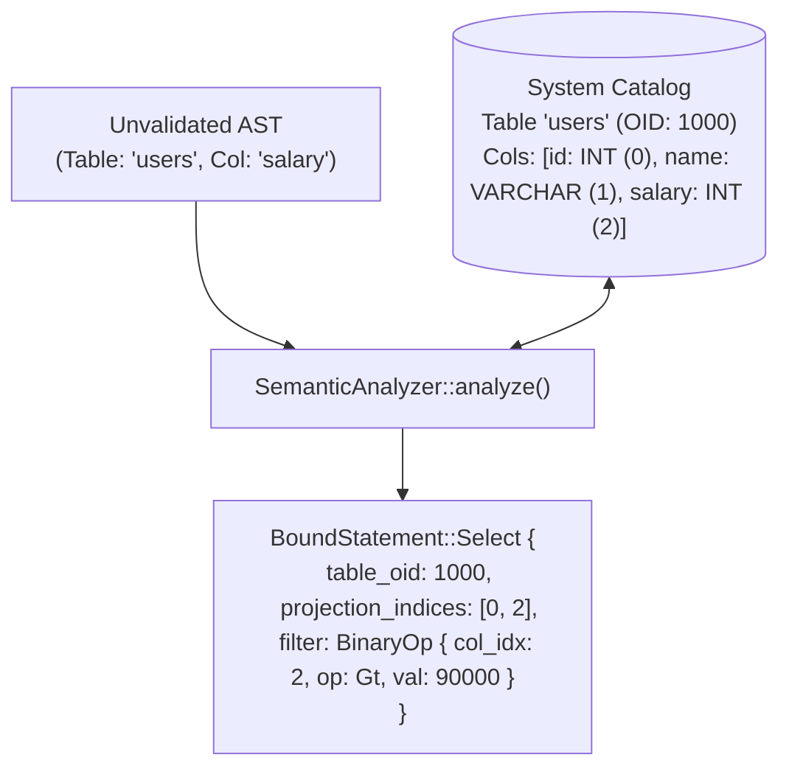

# 06 - Query Planner & Semantic Analysis

## 1. Subsystem Purpose

The AST produced by `jarvix-sql` contains raw identifiers (strings). It does not know:
- Does table `"users"` actually exist in the database?
- Does column `"salary"` belong to `"users"`?
- What physical index within the row does `"salary"` occupy (e.g. column 2)?
- What data type does each expression evaluate to?

The Semantic Analyzer (`jarvix-analyzer`) resolves these questions against the **System Catalog**, producing a validated **`BoundStatement`** with **`BoundExpr`**.



---

## 2. Bound Structures

```rust
// In jarvix-analyzer/src/lib.rs:
#[derive(Debug, Clone, PartialEq)]
pub enum BoundExpr {
    Literal(Value),
    ColumnRef {
        col_idx: usize,      // Resolved 0-based column index in physical row
        col_name: String,
        data_type: DataType, // Resolved relational data type
    },
    BinaryOp {
        left: Box<BoundExpr>,
        op: BinaryOperator,
        right: Box<BoundExpr>,
        return_type: DataType,
    },
    UnaryOp {
        op: UnaryOperator,
        expr: Box<BoundExpr>,
        return_type: DataType,
    },
}
```

---

## 3. Rust Learning Concepts: Options and References

In `jarvix-analyzer`:
```rust
let tbl = catalog.get_table(from).ok_or_else(|| {
    JarvixError::Semantic(format!("Table '{}' not found", from))
})?;
```

### What is happening here?
1. `catalog.get_table(from)` returns `Option<&TableInfo>`:
   - `Some(&table_info)` if the table exists.
   - `None` if it does not.
2. In Rust, you cannot accidentally access a null pointer because `Option` forces you to handle the `None` case.
3. `.ok_or_else(...)` converts `Option<T>` into `Result<T, E>`.
4. The trailing `?` unwraps `T` or returns the error early!

This idiomatic pattern replaces cumbersome `if tbl == null` checks with bulletproof compiler safety.
