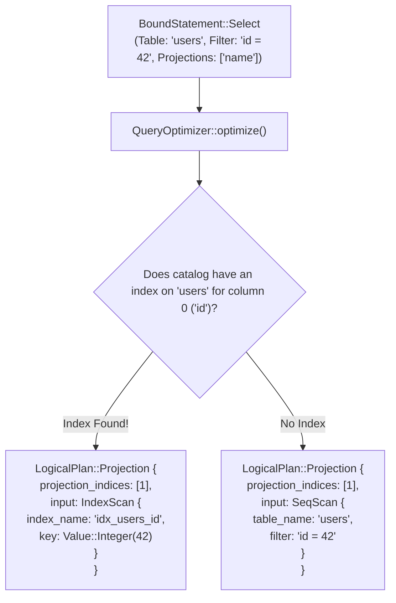

# 07 - Query Optimizer: Rules & Cost Planning

## 1. Subsystem Responsibilities

The Query Optimizer (`jarvix-optimizer`) transforms a `BoundStatement` into an optimal `LogicalPlan`. A naïve query engine executes every query as a full sequential table scan (`SeqScan`). JavixDB's optimizer applies algebraic rewrite rules:

1. **Filter Pushdown**: Evaluates WHERE filter expressions as early as possible (at the scan level) to avoid piping discarded rows through projection nodes.
2. **Index Selection**: Inspects equality predicates (e.g. `WHERE id = 42`). If an index exists on column `id`, the optimizer replaces `SeqScan` with an $O(\log N)$ **`IndexScan`**!
3. **Projection Pruning**: Determines the exact subset of column indices required by outer nodes, eliminating unnecessary deserialization overhead.



---

## 2. Logical Plan Nodes

```rust
// In jarvix-optimizer/src/lib.rs:
#[derive(Debug, Clone, PartialEq)]
pub enum LogicalPlan {
    CreateTable { name: String, schema: Schema, if_not_exists: bool },
    DropTable { name: String, if_exists: bool },
    CreateIndex { name: String, table_name: String, column_idx: usize, unique: bool },
    Insert { table_oid: Oid, table_name: String, column_indices: Vec<usize>, values: Vec<Vec<BoundExpr>> },
    Update { table_oid: Oid, table_name: String, assignments: Vec<(usize, BoundExpr)>, scan: Box<LogicalPlan> },
    Delete { table_oid: Oid, table_name: String, scan: Box<LogicalPlan> },
    SeqScan { table_oid: Oid, table_name: String, filter: Option<BoundExpr> },
    IndexScan {
        table_oid: Oid,
        table_name: String,
        index_oid: Oid,
        index_name: String,
        column_idx: usize,
        key: Value,
        filter: Option<BoundExpr>,
    },
    Projection { projection_indices: Vec<usize>, input: Box<LogicalPlan> },
    Limit { limit: usize, input: Box<LogicalPlan> },
}
```

---

## 3. Algorithm: Index Selection Rule

The function `extract_index_match` recursively inspects binary operator expressions:
- If expression is `BinaryOp { left: ColumnRef(col_idx), op: Eq, right: Literal(val) }`:
  - Check if `indexes.iter().any(|idx| idx.column_idx == col_idx)`.
  - If match found: return `Some((col_idx, val, remaining_filter))`.
- If expression is `BinaryOp { op: And, left, right }`:
  - Recursively search left child; if indexed, keep right child as remaining filter.
  - Recursively search right child; if indexed, keep left child as remaining filter.

### Time & Space Complexity:
- **Time Complexity**: $O(K \times I)$, where $K$ is expression tree depth and $I$ is the number of indexes on the table (typically $< 10$).
- **Space Complexity**: $O(K)$ stack frames during recursive AST traversal.
