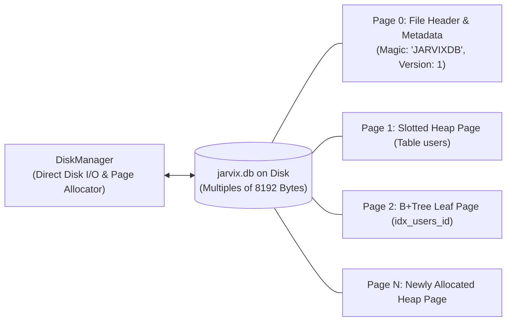

# 09 - Storage Engine & Disk Manager

## 1. Overview & File Layout

The storage subsystem (`jarvix-storage`) manages the persistent representation of database pages on non-volatile physical storage (NVMe SSD / HDD).

JavixDB uses a fixed **8 KB (8192 bytes)** physical page size—identical to PostgreSQL:
- Page 0 is the **Database Metadata Page** containing the magic bytes `JARVIXDB`, database format version, and initial page count.
- Pages 1..N are allocated sequentially and store either Heap Slotted Pages, B+Tree Leaf Pages, or B+Tree Internal Pages.



---

## 2. DiskManager Implementation

```rust
// In jarvix-storage/src/disk.rs:
pub struct DiskManager {
    file_path: PathBuf,
    file: Mutex<File>,
    num_pages: AtomicU32,
}
```

### Key Methods:
- **`open(path)`**: Opens or initializes database file, reads file header on Page 0, verifies file size is an exact multiple of 8192 bytes, and computes `num_pages`.
- **`allocate_page()`**: Atomically increments `num_pages` using `AtomicU32::fetch_add(1, Ordering::SeqCst)`, writes an empty 8 KB page frame at the end of the file, and returns the newly assigned `PageId`.
- **`read_page(page_id, page)`**: Seeks to byte offset `page_id * 8192` and reads 8192 bytes directly into `page.data`.
- **`write_page(page_id, page)`**: Seeks to byte offset `page_id * 8192` and writes the 8192-byte page frame.
- **`sync()`**: Issues an OS `fsync` (`file.sync_data()`) to ensure buffered writes reach physical storage.

---

## 3. Rust Learning Concepts: Atomic Types (`AtomicU32`) & `Ordering`

Why does `DiskManager` use `num_pages: AtomicU32` instead of a regular `u32`?

In a multi-threaded database, multiple transactions might concurrently insert rows and request new pages:
- If two threads read a plain `u32` simultaneously, both might read `5`, allocate page `5`, and overwrite each other's data!
- An `AtomicU32` allows hardware-level atomic CPU instructions (like `LOCK XADD` on x86-64).

```rust
// Atomic fetch and increment: guarantees thread 1 gets 5, thread 2 gets 6!
let new_page_id = self.num_pages.fetch_add(1, Ordering::SeqCst);
```

### What is `Ordering::SeqCst`?
- **Sequentially Consistent (`SeqCst`)**: The strongest memory ordering in Rust. It guarantees that all threads observe the atomic operation in the exact same global order, preventing subtle CPU instruction reordering bugs.
