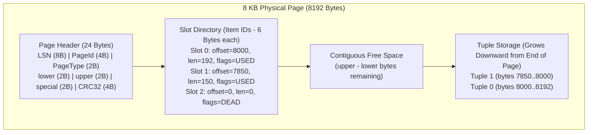

# 10 - Page Management & Slotted Page Storage

## 1. Overview & Slotted Page Architecture

JavixDB uses a **Slotted Page Architecture** for heap tables, identical to PostgreSQL's `PageHeaderData` and `ItemIdData` design. In relational databases, rows (tuples) have variable lengths due to types like `VARCHAR` and nullable attributes. A naive array layout cannot handle variable-length rows without wasting massive amounts of disk space or requiring expensive row shifts during deletion.

The slotted page layout solves this by bifurcating the 8 KB page:
1. **Header & Slot Directory (Item IDs)** grow **downward** (from offset 24 towards offset 8192).
2. **Tuple Data** grows **upward** (from offset 8192 towards the slot directory).
3. **Free Space** is the contiguous gap between `lower` (the end of the slot directory) and `upper` (the start of the lowest tuple).



---

## 2. Page Header & ItemId Layout

### 2.1 Header Byte Offsets

| Offset Range | Field | Type | Description |
|---|---|---|---|
| `0..8` | `lsn` | `u64` | Log Sequence Number of the last WAL record modifying this page |
| `8..12` | `page_id` | `u32` | Logical Page ID within the database file |
| `12..14` | `page_type` | `u16` | Type: `Heap=1`, `BTreeInternal=2`, `BTreeLeaf=3`, `Overflow=4` |
| `14..16` | `lower` | `u16` | Byte offset to the end of the slot directory (points to start of free space) |
| `16..18` | `upper` | `u16` | Byte offset to the start of the topmost tuple (points to end of free space) |
| `18..20` | `special` | `u16` | Byte offset to special area (used by B+Tree for sibling pointers; 8192 for heap) |
| `20..24` | `checksum` | `u32` | CRC32-IEEE checksum of the page contents |

### 2.2 ItemId (Slot) Layout (6 Bytes)

Every slot in the directory contains 6 bytes:
- `offset` (`u16`, 2 bytes): Byte offset from page start to the tuple data.
- `length` (`u16`, 2 bytes): Length of the tuple payload in bytes.
- `flags` (`u16`, 2 bytes): Status flags (`UNUSED = 0x00`, `USED = 0x01`, `REDIRECTED = 0x02`, `DEAD = 0x04`).

---

## 3. Tuple Operations Lifecycle

### 3.1 Tuple Insertion
1. **Free Space Check**: Insertion requires `ITEM_ID_SIZE (6 bytes) + tuple_bytes.len()`. If `upper - lower < required`, insertion fails with `JarvixError::PageFull`.
2. **Reuse or Append Slot**:
   - The engine first scans existing slots for any slot marked `UNUSED` or `DEAD`.
   - If found, that slot index is reused (avoiding slot directory growth).
   - Otherwise, a new slot is appended at byte offset `lower`, and `lower` is incremented by 6.
3. **Write Tuple Data**:
   - `upper` is decremented by `tuple_bytes.len()`.
   - The tuple payload is copied into `page.data[upper..upper + len]`.
4. **Update Slot Pointer**:
   - The slot's `offset` is set to `upper`, `length` is set to `tuple_bytes.len()`, and `flags` is set to `USED`.
5. **Return TupleId (`RecordId`)**:
   - Returns `(page_id, slot_id)`. This pointer remains stable even if other tuples are moved or compacted!

### 3.2 Tuple Deletion & Compaction
When a tuple is deleted:
1. The slot's `flags` is changed to `DEAD`.
2. The tuple's payload is zeroed or marked invalid.
3. If fragmentation occurs (interspersed dead spaces), `Page::compact()` reorganizes all active tuples contiguously against the top of the page, resetting `upper` and reclaiming wasted bytes.

```mermaid
sequenceDiagram
    autonumber
    actor Engine as Query Executor
    participant Page as Slotted Page (PageId 4)
    participant Slot as Slot Directory
    participant Storage as Tuple Data Area

    Engine->>Page: insert_tuple(payload)
    Page->>Page: check free space (upper - lower >= len + 6)
    Page->>Storage: upper -= len; copy payload into [upper..upper+len]
    Page->>Slot: write ItemId { offset: upper, len, flags: USED }
    Page->>Page: lower += 6 (if new slot appended)
    Page-->>Engine: Ok(SlotId 2) -> RecordId(4, 2)
```

---

## 4. Rust Learning Concepts: Memory Alignment, ByteOrder & In-Place Mutation

### Concept 1: Memory Alignment with `#[repr(C, align(4096))]`
```rust
#[repr(C, align(4096))]
pub struct Page {
    pub data: [u8; PAGE_SIZE],
}
```
**Why alignment matters**:
- Direct I/O (`O_DIRECT` / Windows unbuffered I/O) requires buffers in memory to be aligned to physical sector boundaries (typically 4096 bytes / 4 KB).
- By annotating `Page` with `align(4096)`, the Rust compiler guarantees that every `Page` allocated on the heap or stack starts at a memory address that is a multiple of 4096. This allows zero-copy DMA transfers directly between disk controllers and RAM.

### Concept 2: Safe Binary Serialization with `byteorder`
```rust
use byteorder::{BigEndian, ByteOrder};

let offset = BigEndian::read_u16(&buf[0..2]);
BigEndian::write_u16(&mut buf[0..2], self.offset);
```
**Why not use native integer casts (`transmute`)?**
- Different CPU architectures have different endianness (x86 is Little-Endian, ARM/MIPS can be Big-Endian).
- If you cast pointers directly, a database file written on an x86 machine would be corrupted if opened on a big-endian server.
- Explicitly encoding with `BigEndian` ensures file format portability across all platforms and operating systems.
