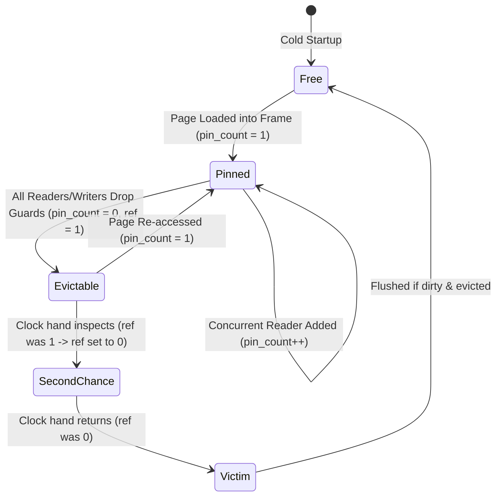

# 11 - Buffer Pool Manager & Clock Eviction

## 1. Overview & Architecture

Relational database performance is governed by the memory hierarchy. Disk I/O is 1,000x to 100,000x slower than RAM. The **Buffer Pool Manager** (`jarvix-buffer`) acts as an in-memory cache between database execution engines and the physical disk.

JavixDB's buffer pool maintains a fixed pool of memory frames (default 1024 frames = 8 MB cache). Every page accessed during query execution is fetched through the buffer pool.

```mermaid
flowchart TD
    subgraph Execution["Executors & Transactions"]
        E1["SeqScan Executor"]
        E2["IndexScan Executor"]
        E3["Insert Executor"]
    end

    subgraph BPM["BufferPoolManager"]
        PT["Page Table\n(HashMap<PageId, FrameId>)"]
        FL["Free List\n(Vec<FrameId>)"]
        CR["ClockReplacer\n(Second-Chance Eviction)"]
        FRAMES["Array of Frames: [RwLock<Page>; POOL_SIZE]"]
    end

    subgraph Disk["Disk Storage"]
        DM["DiskManager"]
        DBFILE[("jarvix.db")]
    end

    E1 -->|fetch_page_read(PageId)| BPM
    E2 -->|fetch_page_read(PageId)| BPM
    E3 -->|fetch_page_write(PageId)| BPM

    BPM --> PT
    BPM --> FL
    BPM --> CR
    BPM --> FRAMES
    BPM <-->|Read / Flush Page| DM
    DM <--> DBFILE
```

---

## 2. Core Components

### 2.1 The Frame Array
A frame is an in-memory slot capable of holding exactly one 8 KB `Page`. Each frame is protected by an independent `RwLock<Page>`, allowing concurrent readers to read the same page simultaneously without blocking one another.

### 2.2 Page Table & Free List
- **`page_table: HashMap<PageId, FrameId>`**: Maps logical database page IDs to their physical memory frame index in the pool.
- **`free_list: Vec<FrameId>`**: Pre-allocated stack of unused frames available on cold startup.

### 2.3 Clock Replacer (Second-Chance Algorithm)
When all frames are occupied and a new page must be fetched from disk, an existing page must be **evicted**. JavixDB implements the **Clock Eviction Algorithm** (`ClockReplacer`):
1. A circular pointer (`clock_hand`) scans across frame metadata.
2. If a frame has an active pin count (`pin_count > 0`), it is in active use and skipped.
3. If unpinned and `referenced == true`, the replacer gives it a "second chance", clears `referenced = false`, and advances the hand.
4. If unpinned and `referenced == false`, this frame is chosen as the **victim**. If it is dirty, it is flushed to disk before being replaced.



---

## 3. RAII Guards & Automated Pin Management

In manual C/C++ database implementations (like PostgreSQL or MySQL), forgetting to unpin a buffer leads to **buffer leak / pin starvation**, eventually freezing the entire database.

In JavixDB, Rust's **RAII (Resource Acquisition Is Initialization)** pattern guarantees that buffers can never leak:

```rust
// Fetching a read guard pins the page
let read_guard = buffer_pool.fetch_page_read(page_id)?;
let slot = read_guard.get_tuple(slot_id);
// When read_guard goes out of scope, Drop executes automatically:
// - Decrements pin_count
// - If pin_count reaches 0, notifies ClockReplacer that frame is evictable!
```

### `PageReadGuard` and `PageWriteGuard`
```rust
pub struct PageReadGuard<'a> {
    pub(crate) frame_id: FrameId,
    pub(crate) guard: RwLockReadGuard<'a, Page>,
    pub(crate) inner: Arc<BufferPoolInner>,
}

impl<'a> Drop for PageReadGuard<'a> {
    fn drop(&mut self) {
        self.inner.unpin_frame(self.frame_id, false); // is_dirty = false
    }
}

pub struct PageWriteGuard<'a> {
    pub(crate) frame_id: FrameId,
    pub(crate) guard: RwLockWriteGuard<'a, Page>,
    pub(crate) inner: Arc<BufferPoolInner>,
}

impl<'a> Drop for PageWriteGuard<'a> {
    fn drop(&mut self) {
        self.inner.unpin_frame(self.frame_id, true);  // is_dirty = true
    }
}
```

---

## 4. Rust Learning Concepts: `Deref`, `DerefMut` and RAII `Drop`

### Concept 1: Transparent Access via `Deref`
Notice that callers can call page methods directly on `PageReadGuard`:
```rust
let tuple = read_guard.get_tuple(slot_id);
```
Even though `get_tuple` is defined on `Page`, not `PageReadGuard`! How does this work?
Rust's `Deref` trait enables **deref coercion**:
```rust
impl<'a> Deref for PageReadGuard<'a> {
    type Target = Page;

    fn deref(&self) -> &Self::Target {
        &self.guard
    }
}
```
When you call a method not found on `PageReadGuard`, the compiler automatically inserts `deref()` to find the method on `Page`.

### Concept 2: The `Drop` Trait as a Guarantee
In Rust, `Drop::drop` is invoked automatically when a variable leaves its scope—whether the function completes normally, encounters an early `return ?`, or panics!
This makes resource leaks impossible in safe Rust:
- `PageWriteGuard` sets `is_dirty = true` and unpins the frame on exit.
- No developer needs to remember `buffer_pool.unpin(page_id, true)`.
