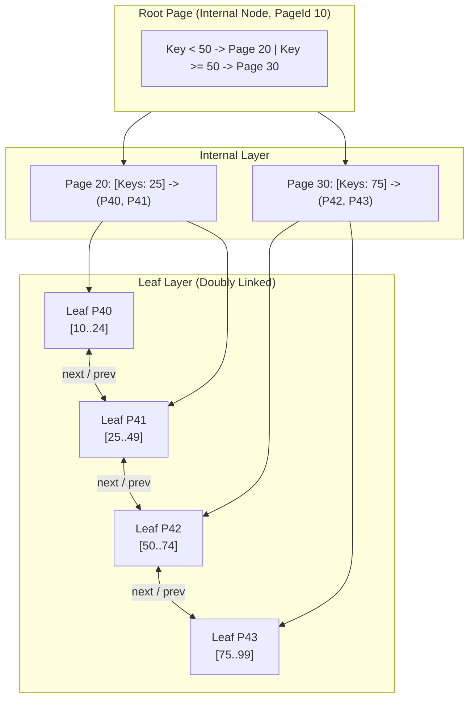
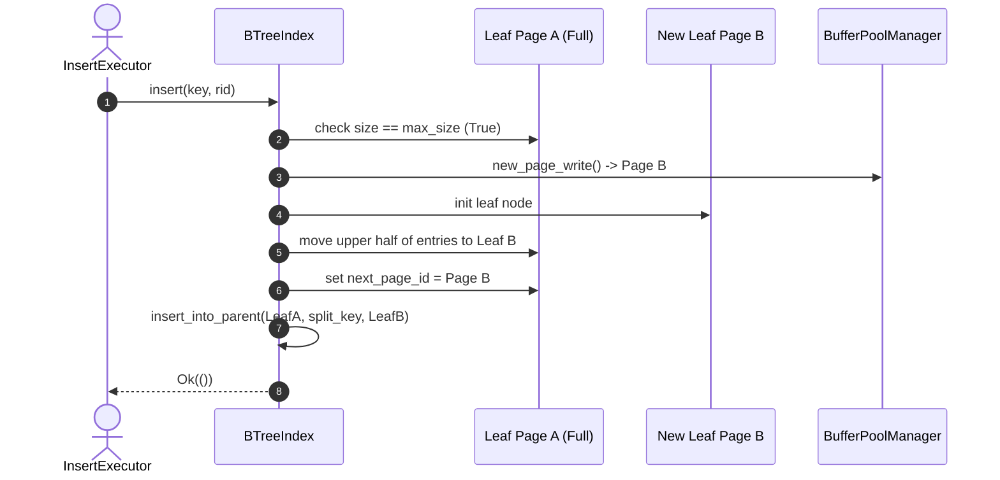

# 12 - Indexing & Concurrent B+Tree

## 1. Overview & Architecture

Indexes in JavixDB provide $O(\log N)$ logarithmic key lookups and efficient sequential range scans for `WHERE column BETWEEN x AND y` or `ORDER BY column`.

JavixDB implements a **disk-backed B+Tree** (`jarvix-index`):
- All data records (`RecordId` = `PageId` + `SlotId`) reside solely in **Leaf Pages**.
- **Internal Pages** contain only routing keys and child `PageId` pointers.
- All leaf pages are doubly-linked via `next_page_id` and `prev_page_id` pointers, allowing horizontal index range scans without traversing back up to parent nodes.



---

## 2. Page Physical Layouts

Both internal and leaf nodes reside on standard 8 KB pages and share a 40-byte header:
1. **Database Page Header** (bytes `0..24`): LSN, PageId, PageType (`BTreeInternal` or `BTreeLeaf`).
2. **BTree Node Header** (bytes `24..40`):
   - `size`: Current number of keys stored (`u16`).
   - `max_size`: Maximum capacity before node split (`u16`).
   - `parent_page_id`: PageId of the parent node (`u32`).
   - `next_page_id` / `prev_page_id`: Sibling pointers for leaf chaining (`u32` each).

### 2.1 Leaf Node Layout
```
+--------------------+-----------------------+-----------------------+
| Header (40 bytes)  | Keys: i64 * max_size  | Vals: RecordId * max  |
+--------------------+-----------------------+-----------------------+
```
- Each key is an 8-byte signed integer (`i64`).
- Each value is a 6-byte `RecordId` (`page_id: u32`, `slot_id: u16`).
- Max capacity is ~250 entries per 8 KB page.

### 2.2 Internal Node Layout
```
+--------------------+-----------------------+-----------------------+
| Header (40 bytes)  | Keys: i64 * max_size  | Child PageIds: u32 *  |
+--------------------+-----------------------+-----------------------+
```
- Key 0 is unused/dummy; Child 0 holds pointer for values less than Key 1.
- Max capacity is ~500 routing entries per 8 KB page.

---

## 3. B+Tree Operations

### 3.1 Key Search: Point Lookup (`search(key)`)
1. Start at `root_page_id`.
2. While current page is `BTreeInternal`:
   - Fetch read guard from `BufferPoolManager`.
   - Perform binary search over keys: find greatest index where `keys[i] <= key`.
   - Read `child_page_id = internal.value_at(index)`.
   - Drop current guard and descend to child page.
3. Once a `BTreeLeaf` is reached:
   - Perform binary search for `key`.
   - If exact match found, return `Some(leaf.value_at(index))` (`RecordId`).
   - Else return `None`.

### 3.2 Range Scan (`scan_range(low, high)`)
1. Traverse down to the leaf node containing `low`.
2. Collect all `RecordId`s where `low <= key <= high`.
3. If end of current leaf is reached and highest key $< high$:
   - Follow `next_page_id` to the right sibling leaf.
   - Continue until key $> high$ or `next_page_id == INVALID_PAGE_ID`.

### 3.3 Insertion & Node Splitting
When inserting into a leaf that has reached `max_size`:
1. Allocate a new leaf page from the buffer pool.
2. Move upper half of key-value pairs (from index `size / 2` to `size`) into the new sibling.
3. Link sibling pointers:
   - `new_sibling.next_page_id = old_leaf.next_page_id`.
   - `old_leaf.next_page_id = new_sibling_id`.
4. Copy the first key of the new sibling and promote it to the parent internal node.
5. If the parent internal node is also full, split recursively up to the root.
6. If the root splits, allocate a new root internal page, link both children, and atomically update `self.root_page_id`.



---

## 4. Rust Learning Concepts: Binary Search on Slices & Zero-Copy Casting

### Concept 1: Custom Binary Search over Binary Records
Because keys are laid out contiguously in raw byte slices (`[u8; 8192]`), JavixDB performs $O(\log K)$ binary search without allocating temporary Rust vectors:
```rust
pub fn key_index(&self, page: &Page, key: i64) -> usize {
    let size = Self::size(page) as usize;
    let mut low = 0;
    let mut high = size;

    while low < high {
        let mid = (low + high) / 2;
        let mid_key = self.key_at(page, mid);
        if mid_key < key {
            low = mid + 1;
        } else {
            high = mid;
        }
    }
    low
}
```

### Concept 2: Stateless Struct Pattern (`BTreeLeafPage`)
Notice that `BTreeLeafPage` has no fields (`pub struct BTreeLeafPage;`).
Why design it this way?
- If `BTreeLeafPage` owned the data, we would have to copy 8 KB into the struct on every access.
- Instead, `BTreeLeafPage` is a namespace of static functions that operate directly on `&Page` or `&mut Page` buffers borrowed from `PageReadGuard` or `PageWriteGuard`.
- This achieves **zero allocations and zero data copying** during tree traversal!
