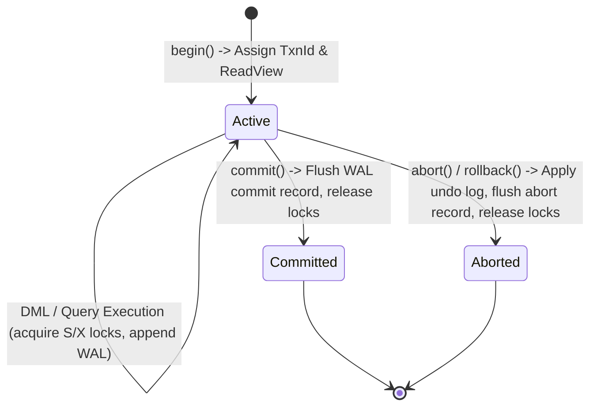
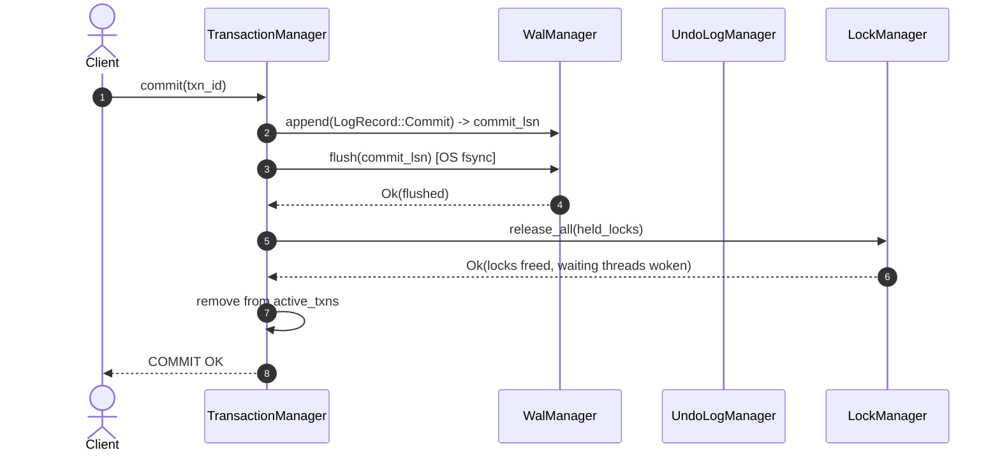

# 13 - Transaction Manager & ACID Guarantees

## 1. Overview & ACID Lifecycle

The **Transaction Manager** (`jarvix-txn`) coordinates multi-client concurrent execution while strictly maintaining database **ACID properties**:
- **Atomicity**: Changes made by a transaction are all committed or all rolled back.
- **Consistency**: The database transitions from one valid schema/constraint state to another.
- **Isolation**: Concurrent transactions execute without dirty reads, non-repeatable reads, or phantom reads (governed by configured `IsolationLevel`).
- **Durability**: Once `COMMIT` returns success, modifications are guaranteed to survive power outages or operating system crashes via Write-Ahead Logging (WAL).



---

## 2. Transaction Architecture & Data Structures

```rust
pub struct Transaction {
    txn_id: TxnId,
    isolation_level: IsolationLevel,
    state: RwLock<TransactionState>,
    prev_lsn: AtomicU64,
    read_view: RwLock<Option<ReadView>>,
    held_locks: Mutex<HashSet<LockKey>>,
}
```

### Key Responsibilities of `Transaction`:
- **`txn_id`**: Monotonically increasing 64-bit integer assigned by `AtomicU64::fetch_add`.
- **`prev_lsn`**: Points to the most recent WAL record generated by this transaction, forming an in-WAL backward linked list for fast transaction rollback and crash recovery.
- **`read_view`**: The point-in-time MVCC visibility snapshot created when the transaction begins.
- **`held_locks`**: The complete set of Table and Row lock keys held by this transaction under Strict Two-Phase Locking (SS2PL).

---

## 3. Commit & Abort Execution Lifecycles

### 3.1 Commit Protocol
1. **Prepare Phase**: The transaction transitions its state to `TransactionState::Committed`.
2. **Log WAL Commit**: Appends a `LogRecord::Commit` to the WAL containing `txn_id` and `prev_lsn`.
3. **Synchronous Flush**: Invokes `wal_manager.flush(commit_lsn)`. This forces the WAL buffer to disk (`fsync`), fulfilling Durability.
4. **Release All Locks**: Iterates over `held_locks` and invokes `lock_manager.release_lock()` for every held resource, notifying waiting threads via condition variable (`Condvar::notify_all`).
5. **Deregister Transaction**: Removes `txn_id` from `TransactionManager::active_txns`.

### 3.2 Abort & Rollback Protocol
1. **Transition State**: Marks state as `TransactionState::Aborted`.
2. **Undo Modifications**:
   - Reads the transaction's undo chain from `UndoLogManager`.
   - Reverts each modified row in reverse chronological order:
     - Replaces updated tuples with their `before_image`.
     - Deletes newly inserted tuples from their pages.
     - Re-inserts tuples deleted by this transaction.
3. **Log Abort Record**: Appends a `LogRecord::Abort` to WAL.
4. **Release All Locks**: Releases all held shared and exclusive locks.
5. **Deregister**: Removes transaction from active set.



---

## 4. Rust Learning Concepts: Atomic Monotonic Counters & Thread-Safe Collections

### Concept 1: Global Sequence Allocation with `AtomicU64`
```rust
pub struct TransactionManager {
    next_txn_id: AtomicU64,
    active_txns: Mutex<HashMap<TxnId, Arc<Transaction>>>,
    ...
}
```
- By storing `next_txn_id: AtomicU64`, assigning a new transaction ID never requires acquiring a global lock. Multiple worker threads can begin transactions concurrently using `self.next_txn_id.fetch_add(1, Ordering::SeqCst)`.

### Concept 2: Fine-Grained Locking with `Arc<Transaction>`
- The `TransactionManager` protects its global active map with a `Mutex<HashMap<...>>`, but stores values as `Arc<Transaction>`.
- Once a query worker thread looks up a transaction from the manager, it retains an `Arc<Transaction>` clone and drops the `active_txns` mutex guard immediately!
- Individual transactions can mutate their local state (`RwLock<TransactionState>`, `AtomicU64`) without holding any global manager locks, preventing thread contention bottlenecks.
