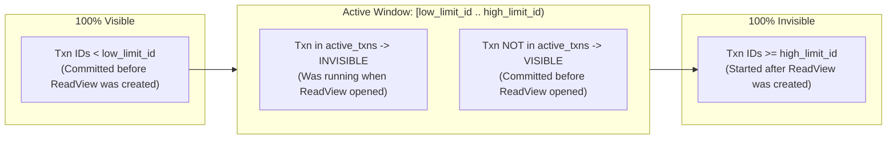

# 14 - Multi-Version Concurrency Control (MVCC) & Visibility

## 1. Overview & Architectural Design

Multi-Version Concurrency Control (MVCC) ensures that **readers never block writers, and writers never block readers**. Readers can query a snapshot of the database at a specific point in time without waiting for concurrent update or insert transactions to complete.

### Architectural Comparison: PostgreSQL vs MySQL/InnoDB

| Feature | PostgreSQL | MySQL / InnoDB | JavixDB |
|---|---|---|---|
| **Version Storage** | Tuples on Heap (`xmin`, `xmax`) | In-place Heap + Undo Log chain | In-place Heap + Undo Log chain |
| **Old Version Cleanup** | Autovacuum table scan | Purge threads clean Undo Logs | Purge upon transaction commit |
| **Write Amplification** | Higher (every UPDATE writes new tuple on heap) | Lower (updates in-place, writes compact undo entry) | Lower (InnoDB-style) |
| **Snapshot Mechanism** | `SnapshotData` (xmin, xmax, xip list) | `ReadView` (low_limit, high_limit, active_txns) | `ReadView` (InnoDB semantics) |

JavixDB adopts the **InnoDB model**: rows are updated in-place, and before-images are preserved in an in-memory **Undo Log Manager**. Point-in-time consistency is governed by a **`ReadView`**.

---

## 2. The `ReadView` Structure & Visibility Boundary

```rust
pub struct ReadView {
    pub creator_txn_id: TxnId,
    pub low_limit_id: TxnId,
    pub high_limit_id: TxnId,
    pub active_txns: HashSet<TxnId>,
}
```



### Visibility Rules Algorithm:
```rust
pub fn is_visible(&self, row_txn_id: TxnId) -> bool {
    // 1. Changes made by the current transaction itself are always visible
    if row_txn_id == self.creator_txn_id {
        return true;
    }

    // 2. Transactions committed prior to the oldest active txn are visible
    if row_txn_id < self.low_limit_id {
        return true;
    }

    // 3. Transactions started after this ReadView was created are invisible
    if row_txn_id >= self.high_limit_id {
        return false;
    }

    // 4. Transactions active at the moment of ReadView creation are invisible
    !self.active_txns.contains(&row_txn_id)
}
```

---

## 3. Isolation Levels

JavixDB supports two primary ANSI SQL isolation levels:

1. **`ReadCommitted`**:
   - Every individual SQL statement generates a brand new `ReadView` right before execution begins.
   - Any transaction committed between statement 1 and statement 2 becomes immediately visible to statement 2.
2. **`RepeatableRead`**:
   - A single `ReadView` is created during `BEGIN` (or the first read statement).
   - The same `ReadView` is reused for all subsequent queries within the transaction, guaranteeing that repeated queries return the exact same rows regardless of external commits.

```mermaid
sequenceDiagram
    autonumber
    actor T1 as Txn 1 (RepeatableRead)
    actor T2 as Txn 2
    participant DB as JavixDB Engine

    T1->>DB: BEGIN -> Create ReadView (high_limit = 100)
    T2->>DB: BEGIN -> Txn 101
    T2->>DB: INSERT INTO users VALUES (42, 'Alice'); COMMIT;
    T1->>DB: SELECT * FROM users WHERE id = 42
    DB->>DB: check row_txn_id (101) >= high_limit_id (100) -> INVISIBLE!
    DB-->>T1: Empty Result (Row 42 hidden!)
```

---

## 4. Rust Learning Concepts: Enums as States & Copy Semantics

### Concept 1: Copy vs Clone Enums
```rust
#[derive(Debug, Clone, Copy, PartialEq, Eq)]
pub enum IsolationLevel {
    ReadCommitted,
    RepeatableRead,
    Serializable,
}
```
- In Rust, types marked with `Copy` are copied by simple bitwise reproduction (like integers or booleans).
- Because `IsolationLevel` and `TransactionState` contain no heap pointers, passing them by value `fn set_isolation(level: IsolationLevel)` does not consume or invalidate the caller's variable!

### Concept 2: Safe Hash Sets without Raw Pointers
In C databases, maintaining active transaction lists requires custom linked list pointers inside transaction descriptors, which are vulnerable to dangling pointer bugs.
In Rust, `active_txns: HashSet<TxnId>` is a self-contained heap structure. Calling `.clone()` produces a safe, isolated snapshot in memory that cannot be corrupted even if concurrent transactions concurrently finish and deallocate.
