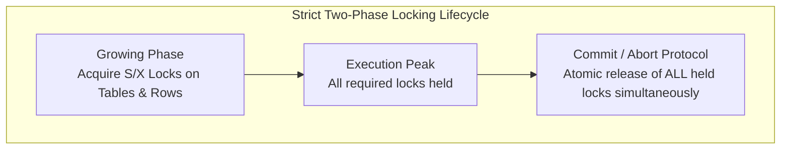
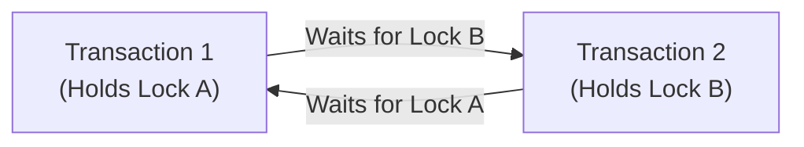

# 15 - Lock Manager & Deadlock Cycle Detection

## 1. Overview & Strict Two-Phase Locking (SS2PL)

To maintain serializability and prevent conflicting concurrent writes, JavixDB implements **Strict Two-Phase Locking (SS2PL)** (`jarvix-txn/src/lock_manager.rs`):
1. **Growing Phase**: Transactions acquire Shared (S) or Exclusive (X) locks on tables or individual rows as operations demand.
2. **Strict Shrinking Phase**: **No locks are ever released prematurely.** All acquired locks are held until the transaction either executes `COMMIT` or `ROLLBACK`.



---

## 2. Lock Hierarchy & Modes

### 2.1 Granularity: Table and Row
```rust
#[derive(Debug, Clone, Copy, PartialEq, Eq, Hash)]
pub enum LockKey {
    Table(Oid),
    Row(RecordId),
}
```
- **Table Lock**: Acquired before full-table scans, DDL operations, or bulk modifications.
- **Row Lock**: Acquired on individual `RecordId`s (`PageId` + `SlotId`) during `UPDATE` or `DELETE`.

### 2.2 Lock Compatibility Matrix

| Existing Lock Mode | Requested Shared (S) | Requested Exclusive (X) |
|---|---|---|
| **None** | Granted | Granted |
| **Shared (S)** | Granted (Concurrent readers) | Blocked (Queued) |
| **Exclusive (X)** | Blocked (unless same txn) | Blocked (unless same txn) |

### 2.3 Re-entrancy & Lock Subsumption
If Transaction $T_1$ already acquired an Exclusive lock on Table $10$, and later invokes an internal sub-query that requests a Shared lock on Table $10$:
- The engine recognizes that Exclusive *subsumes* Shared!
- The lock is granted immediately without blocking or waiting.

---

## 3. Deadlock Detection via Wait-For Graph (WFG)

When multiple transactions wait on locks held by each other, a circular dependency forms—a **deadlock**. For example:
- $T_1$ holds Lock A and requests Lock B.
- $T_2$ holds Lock B and requests Lock A.

Neither can proceed without external intervention.



### Depth-First Search (DFS) Cycle Detection Algorithm
Whenever a lock request cannot be immediately granted:
1. Directed edges are inserted into the Wait-For Graph: `requesting_txn -> holder_txn`.
2. The lock manager runs a recursive DFS cycle check starting from `requesting_txn`.
3. If the traversal discovers a path that cycles back to `requesting_txn`, a deadlock is detected!
4. The lock manager cleans up the graph and immediately returns `Err(JarvixError::Deadlock(txn_id))`, allowing the transaction manager to abort the victim transaction and unblock the other.

```rust
fn has_deadlock(&self, wfg: &HashMap<TxnId, HashSet<TxnId>>, start_txn: TxnId) -> bool {
    let mut visited = HashSet::new();
    let mut path = HashSet::new();
    self.dfs(start_txn, wfg, &mut visited, &mut path)
}
```

---

## 4. Thread Parking with Condition Variables (`Condvar`)

When a lock is blocked and no deadlock exists, the calling thread must sleep without burning CPU cycles:
```rust
loop {
    // Atomically releases the mutex and suspends the thread
    table = self.cvar.wait(table).unwrap();

    // Woken up by another transaction committing or releasing locks!
    if queue.can_grant(mode, txn_id) {
        // Mark granted and exit loop
        break;
    }
}
```

When a transaction commits and releases locks, it calls:
```rust
self.cvar.notify_all();
```
This wakes up all sleeping worker threads to re-evaluate their lock queue position!

---

## 5. Rust Learning Concepts: Condition Variables & Graph Cycle Traversal

### Concept 1: The Mutex-Condvar Dance
In Rust, `Condvar::wait(guard)` takes an owned `MutexGuard<'a, T>` and returns an updated `LockResult<MutexGuard<'a, T>>`.
**Why?**
- If the thread fell asleep while still holding the mutex, no other thread could ever acquire the mutex to release the lock!
- `wait()` atomically unlocks the mutex and puts the thread to sleep in a single atomic OS kernel call.
- Upon waking, it automatically re-acquires the mutex before returning execution to your code.

### Concept 2: Graph Recursion with Visited Sets
In the DFS cycle detector, two sets are maintained:
- `visited: HashSet<TxnId>`: Nodes already completely explored across all paths (prevents re-exploring acyclic branches).
- `path: HashSet<TxnId>`: Nodes currently on the active recursion stack. If a child node is already in `path`, a back-edge (cycle) has been discovered!
