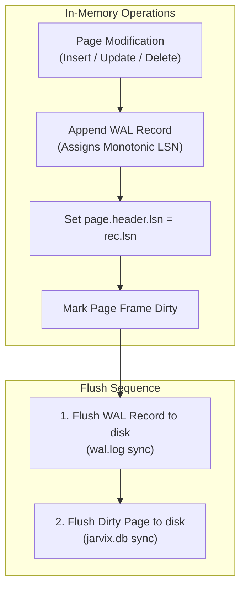
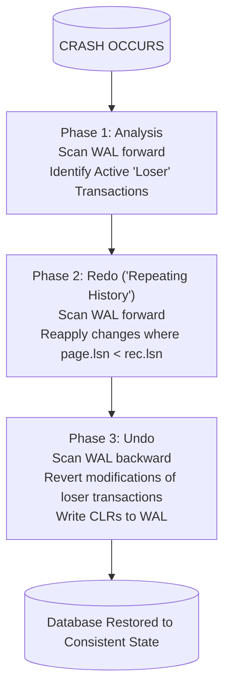

# 16 - Write-Ahead Logging (WAL) & ARIES Crash Recovery

## 1. Overview & The WAL Invariant

Write-Ahead Logging (WAL) guarantees the **Durability** property of ACID: no matter when a power outage or kernel crash occurs, committed data is never lost, and uncommitted data is never left partially applied.

### The Fundamental WAL Rule:
> **The log record for any database modification must be securely flushed to persistent disk storage BEFORE the corresponding modified dirty page can be written to the database file.**

$$\text{page.lsn} \le \text{flushed\_lsn}$$

If this rule were violated, a dirty page written to disk would contain changes that crash recovery could not undo if the system failed before the log record was flushed.



---

## 2. WAL Record Layout

Every WAL record in `jarvix-wal` is serialized with the following binary layout:
- `lsn` (`u64`, 8 bytes): Monotonically increasing Log Sequence Number.
- `prev_lsn` (`u64`, 8 bytes): LSN of the previous record written by this transaction.
- `txn_id` (`u64`, 8 bytes): Transaction ID.
- `record_type` (`u8`, 1 byte): Enum identifying operation:
  - `Begin = 1`, `Commit = 2`, `Abort = 3`
  - `Insert = 4`, `Update = 5`, `Delete = 6`
  - `Clr = 7` (Compensation Log Record)
- `page_id` (`u32`, 4 bytes): Affected page.
- `slot_id` (`u16`, 2 bytes): Affected slot in page.
- `undo_next_lsn` (`u64`, 8 bytes): Pointer used by CLRs to skip already undone operations.
- `before_image` (variable length): Tuple data prior to modification (for undo).
- `after_image` (variable length): Tuple data following modification (for redo).

---

## 3. ARIES 3-Phase Crash Recovery Algorithm

JavixDB implements the industry-standard **ARIES (Algorithms for Recovery and Isolation Exploiting Semantics)** crash recovery algorithm (`jarvix-wal/src/recovery.rs`):



### Phase 1: Analysis Phase
- Scans the entire WAL file sequentially from the beginning to the end.
- Reconstructs the exact state of active transactions at the time of the crash.
- Identifies **loser transactions**: any transaction that logged `Begin` but never logged `Commit` or `Abort`.

### Phase 2: Redo Phase ("Repeating History")
- Scans forward through all records.
- For each record affecting a page (`Insert`, `Update`, `Delete`, `Clr`):
  - Fetches the page through `BufferPoolManager`.
  - Checks if `page.lsn() < rec.lsn`.
  - If true, the change is missing from disk! Re-applies `rec.after_image` and updates `page.lsn = rec.lsn`.
  - If `page.lsn() >= rec.lsn`, the modification was already flushed before the crash, and redo is safely skipped!

### Phase 3: Undo Phase
- Rolls back all active loser transactions identified during the Analysis phase.
- Processes records backward using the `prev_lsn` chains.
- For each undone modification:
  - Reverts the change on the slotted page using `rec.before_image`.
  - Writes a **Compensation Log Record (CLR)** to the WAL.
  - Sets `clr.undo_next_lsn = rec.prev_lsn`.
- **Why CLRs?** If the server crashes *during* recovery, the next recovery run reads the CLR, follows `undo_next_lsn`, and avoids undoing an already undone operation. This makes crash recovery strictly **idempotent**!

---

## 4. Rust Learning Concepts: Binary Slicing & Serialization

### Concept 1: Variable-Length Serialization
In `LogRecord::serialize(&self, buf: &mut Vec<u8>)`:
```rust
buf.extend_from_slice(&(self.before_image.len() as u32).to_be_bytes());
buf.extend_from_slice(&self.before_image);
```
- Variable payloads (like `VARCHAR` tuples) are prefixed by their length (`u32` Big-Endian).
- During deserialization, the parser reads the 4-byte length $L$, slices exactly $L$ bytes from the buffer, and converts it to a `Vec<u8>`.

### Concept 2: Rust's Match for Exhaustive State Handling
During recovery, Rust's `match rec.record_type` forces every possible log record variant to be handled explicitly. The compiler ensures no new log record types can be introduced without updating recovery logic, preventing unhandled crash bugs at compile time.
