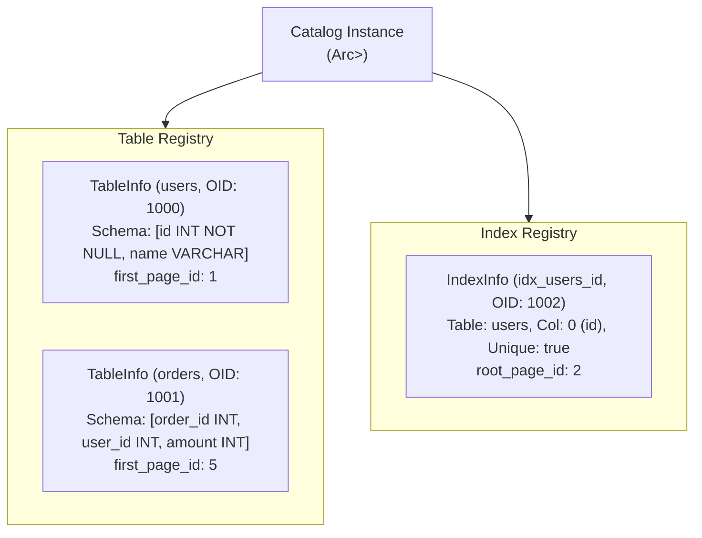

# 17 - System Catalog & Schema Metadata

## 1. Overview & Catalog Architecture

The **System Catalog** (`jarvix-catalog`) is the database's internal registry of metadata. It maintains definitions for tables, columns, data types, constraints, and secondary B+Tree indexes.

Every relational object in JavixDB is assigned a unique **Object Identifier (OID)**—modeled directly after PostgreSQL's `oid` architecture.



---

## 2. Core Metadata Structs

### 2.1 `TableInfo`
```rust
pub struct TableInfo {
    pub oid: Oid,
    pub name: String,
    pub schema: Schema,
    pub first_page_id: PageId,
}
```
- **`oid`**: Unique numeric identifier assigned to this table.
- **`name`**: User-facing table name (e.g. `"users"`).
- **`schema`**: Column definitions, data types (`Integer`, `Varchar`, `Boolean`), and nullability constraints.
- **`first_page_id`**: The root heap page for this table's slotted pages.

### 2.2 `IndexInfo`
```rust
pub struct IndexInfo {
    pub oid: Oid,
    pub name: String,
    pub table_name: String,
    pub column_idx: usize,
    pub is_unique: bool,
    pub root_page_id: PageId,
}
```
- **`column_idx`**: 0-based offset of the indexed column within the table schema.
- **`root_page_id`**: The current root page of the underlying B+Tree index.

---

## 3. Catalog Operations & DDL Integration

### 3.1 `create_table(name, schema, first_page)`
1. Checks for duplicate table name (case-insensitively).
2. Allocates a new OID from `next_oid`.
3. Stores `TableInfo` in both `tables` (name lookup) and `tables_by_oid` (reverse lookup).
4. Returns a reference to the registered table.

### 3.2 `create_index(index_name, table_name, column_name, is_unique, root_page_id)`
1. Verifies that the target table exists.
2. Resolves `column_name` to its integer index (`column_idx`).
3. Allocates OID and registers `IndexInfo`.

### 3.3 Dynamic Root Updates for B+Trees
When a B+Tree splits its root node during row insertion, the index root changes:
```rust
pub fn update_index_root(&mut self, index_name: &str, new_root: PageId) -> Result<()>
```
The catalog updates `IndexInfo.root_page_id` in place, ensuring future query scans discover the new root immediately.

---

## 4. Rust Learning Concepts: Borrowing from HashMaps & Bidirectional Lookups

### Concept 1: Returning References from HashMaps
```rust
pub fn get_table(&self, name: &str) -> Option<&TableInfo> {
    self.tables.get(&name.to_lowercase())
}
```
- Why return `Option<&TableInfo>` instead of `TableInfo`?
- Returning a clone would copy the entire `Schema` vector on every query parse!
- Returning an immutable reference `&TableInfo` borrows the data directly from the catalog's memory without any heap allocation.
- The reference's lifetime is tied to `&self`, meaning the caller cannot mutate the catalog while holding the reference, preventing data races.

### Concept 2: Safe Case-Insensitive String Keys
SQL identifiers are traditionally case-insensitive (`SELECT * FROM users` == `SELECT * FROM Users`).
Instead of performing slow case-insensitive string comparisons on every lookup, JavixDB normalizes all keys to lowercase before inserting into `HashMap<String, TableInfo>`, allowing $O(1)$ constant-time lookups.
