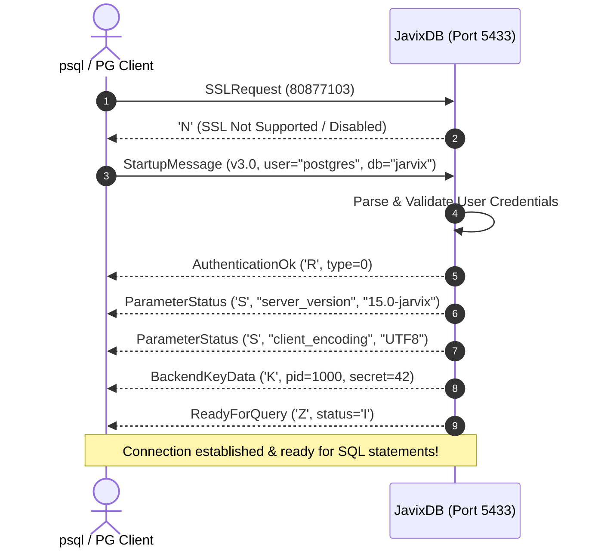

# 18 - Authentication & Wire Handshake Protocol

## 1. Overview & PostgreSQL v3 Compatibility

JavixDB implements the standard **PostgreSQL Wire Protocol Version 3.0** (`jarvix-protocol`), allowing any standard PostgreSQL client—including official `psql`, language drivers (`pg`, `psycopg2`, `npgsql`, `tokio-postgres`), and GUI tools (DBeaver, DataGrip)—to connect directly to JavixDB on port 5433 without requiring custom drivers.

---

## 2. Startup Handshake Lifecycle



---

## 3. Handshake Packet Formats

### 3.1 Startup Message
The client sends an un-typed packet:
```
+----------------+----------------+--------------------------------------+
| Length: 4 bytes| Proto: 4 bytes | Null-terminated key-value strings... |
+----------------+----------------+--------------------------------------+
```
- `Length`: Total packet size (Big-Endian `i32`).
- `Proto`: Protocol version (`196608` for v3.0, or `80877103` for SSL probe).
- `Key-Value Pairs`: Alternating null-terminated strings (`"user\0postgres\0database\0jarvix\0\0"`).

### 3.2 Backend Handshake Response Packets
1. **`AuthenticationOk` (`'R'`)**: Indicates client authentication succeeded without password prompt (or trust auth). Payload is 4-byte integer `0`.
2. **`ParameterStatus` (`'S'`)**: Reports runtime session settings to the client:
   - `server_version`: `"15.0 (JarvixDB 0.1.0)"`
   - `client_encoding`: `"UTF8"`
   - `server_encoding`: `"UTF8"`
3. **`BackendKeyData` (`'K'`)**: Sends a unique `(process_id, secret_key)` pair. The client uses this token if it needs to issue an out-of-band query cancellation request.
4. **`ReadyForQuery` (`'Z'`)**: Single byte status indicating session state:
   - `'I'`: Idle (no active transaction).
   - `'T'`: Inside an active transaction block (`BEGIN`).
   - `'E'`: Inside a failed transaction block (aborted, waiting for `ROLLBACK`).

---

## 4. Rust Learning Concepts: Byte Parsing & Null-Terminated Slices

### Concept 1: Splitting Slices on Byte Delimiters
In C, parsing null-terminated strings requires unsafe pointer arithmetic (`strchr` / `strlen`).
In Rust, the standard library provides slice iterators:
```rust
let payload = &body[4..];
let mut parts = payload.split(|&b| b == 0);

while let Some(key_bytes) = parts.next() {
    if key_bytes.is_empty() {
        break; // Double null indicates end of parameter list
    }
    if let Some(val_bytes) = parts.next() {
        let key = String::from_utf8_lossy(key_bytes).to_string();
        let val = String::from_utf8_lossy(val_bytes).to_string();
        parameters.insert(key, val);
    }
}
```
- `payload.split(|&b| b == 0)` yields sub-slices between `0x00` bytes.
- It performs zero memory copies until `.to_string()` is called!
- It is completely bounds-checked and guaranteed never to read out of memory bounds.
