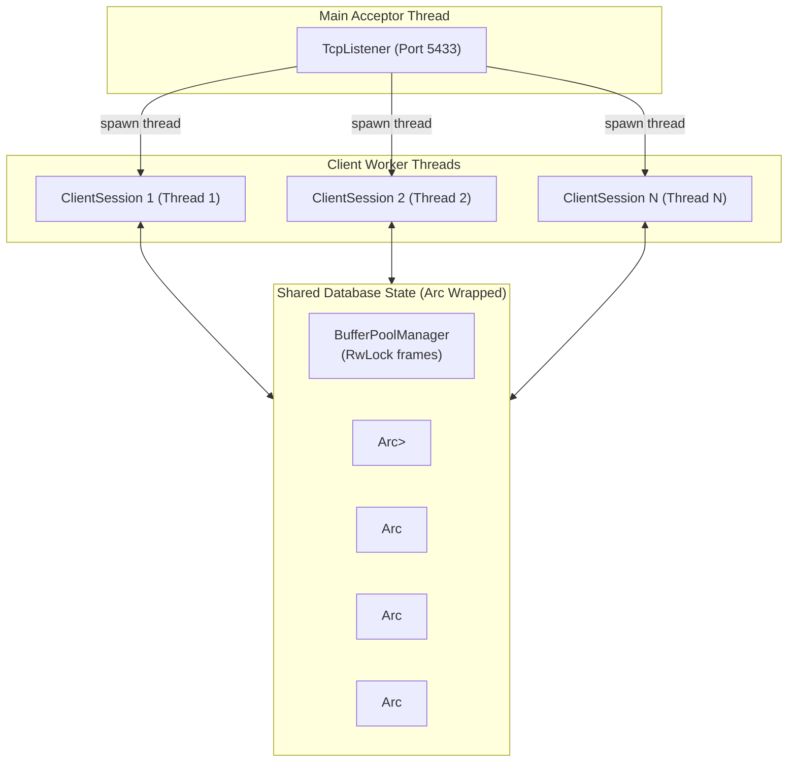

# 19 - Concurrency Model & Multi-Threading Architecture

## 1. Overview: Concurrency Architecture Comparison

Database architectures handle concurrent clients using either multi-process or multi-threaded designs:

| Aspect | PostgreSQL | MySQL (InnoDB) | JavixDB |
|---|---|---|---|
| **Concurrency Model** | Multi-process (`fork()` per client) | Multi-threaded (Thread per client / Thread pool) | Multi-threaded (Thread per client) |
| **Shared Memory** | OS Shared Memory (`shmget` / `mmap`) | Single in-process address space | Single in-process address space |
| **Context Switch Overhead** | Higher (process context switch, TLB shootdowns) | Lower (thread context switch) | Lower (thread context switch) |
| **Safety Guarantees** | Process isolation prevents memory corruption | Requires manual mutex discipline in C++ | Rust compiler guarantees data-race freedom (`Send` + `Sync`) |

JavixDB uses a multi-threaded **Thread-per-Connection** architecture in `jarvix-server`. The server accepts incoming TCP connections on a listener thread and spawns a dedicated worker thread for each client session.



---

## 2. Synchronization Primitives in JavixDB

JavixDB combines four synchronization mechanisms to maximize parallelism while guaranteeing safety:

### 2.1 Reader-Writer Locks (`RwLock`)
- Used for `Catalog` and `BufferPoolManager` frame buffers.
- Allows infinite concurrent reader threads to scan tables or pages simultaneously.
- A writer thread requesting exclusive access blocks subsequent readers until write completion.

### 2.2 Mutexes (`Mutex`)
- Used for short critical sections: registering transactions in `active_txns`, appending to the WAL write buffer, or inserting lock requests into the `LockManager`.
- Mutexes are held for microsecond durations to minimize thread contention.

### 2.3 Atomics (`AtomicU64`, `AtomicU32`)
- Used for allocating monotonically increasing identifiers: `next_txn_id`, `next_page_id`, and `lsn`.
- Execute hardware-level atomic CPU instructions without acquiring OS kernel locks.

### 2.4 Condition Variables (`Condvar`)
- Used by `LockManager` to park threads that are waiting for conflicting locks to release.
- Avoids busy-waiting (`spin-locks`) that waste CPU cycles.

---

## 3. Rust Learning Concepts: `Send`, `Sync`, and Data-Race Freedom

### Concept 1: Fearless Concurrency via `Send` and `Sync`
In C and C++, data races occur when two threads access the same memory location simultaneously and at least one access is a write. These bugs are notoriously difficult to reproduce and debug.

In Rust, data-race freedom is **guaranteed at compile time** by two auto-traits:
- **`Send`**: Indicates that ownership of a type can be safely transferred across thread boundaries.
- **`Sync`**: Indicates that it is safe for multiple threads to access a reference `&T` simultaneously.

```rust
// If a type T is Sync, then &T is Send!
// A type is Sync if and only if Arc<T> is Send.
```

If you attempt to share a non-thread-safe type (like `Rc<T>` or `RefCell<T>`) across a thread in `thread::spawn(...)`, the Rust compiler refuses to compile the program:
```
error[E0277]: `Rc<Catalog>` cannot be sent between threads safely
  = help: the trait `Send` is not implemented for `Rc<Catalog>`
  = note: use `Arc<RwLock<Catalog>>` instead
```

### Concept 2: Safe Multi-Thread Sharing with `Arc<T>`
`Arc` stands for **Atomically Reference Counted**:
```rust
let session_catalog = Arc::clone(&self.catalog);
std::thread::spawn(move || {
    let mut session = ClientSession::new(stream, session_catalog, ...);
    session.run();
});
```
- Calling `Arc::clone(&catalog)` does **not** clone the database catalog!
- It merely increments an atomic reference count on the heap.
- When the worker thread finishes, the `Arc` guard drops, decrementing the reference count. When the last reference drops, the shared memory is automatically freed.
