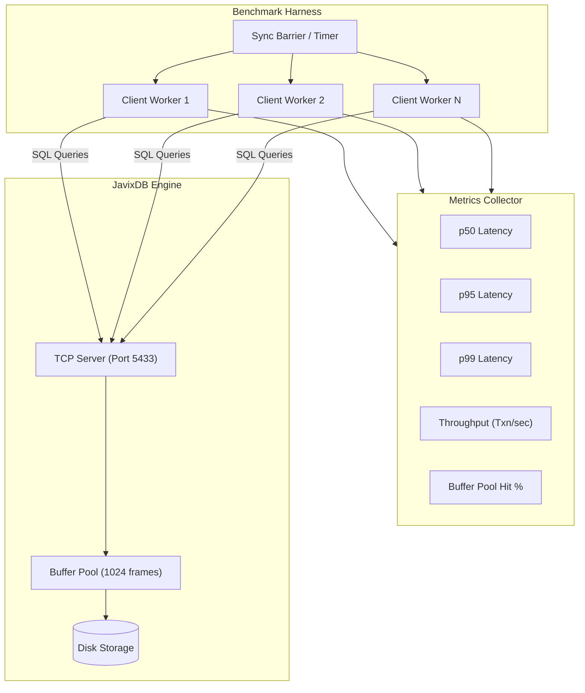

# 20 - Benchmarking & Performance Profiling

## 1. Overview & Benchmark Architecture

Evaluating the throughput, latency, and scalability of an RDBMS requires multi-tiered benchmarking. JavixDB includes performance tests spanning raw disk I/O, buffer cache hits, B+Tree search latencies, and end-to-end multi-client SQL execution.



---

## 2. Benchmark Categories

### 2.1 Microbenchmarks
- **Slotted Page Operations**: Measures the nanoseconds required to append variable-length tuples into an 8 KB page frame and the overhead of in-place `Page::compact()`.
- **Clock Eviction Hit Rate**: Evaluates `ClockReplacer` second-chance accuracy under uniform vs Zipfian page access distributions.
- **B+Tree Traversal Latency**: Measures logarithmic descent through internal pages and leaf binary search under varying index sizes ($10^4$ to $10^6$ entries).

### 2.2 End-to-End Query Throughput
- **Single-Threaded Ingestion**: Measures sequential bulk `INSERT INTO` throughput (records per second).
- **Point Query Lookups**: Compares execution time of `SELECT * FROM users WHERE id = X` using `IndexScan` ($O(\log N)$) versus `SeqScan` ($O(N)$).
- **Range Queries**: Measures streaming throughput for `WHERE id BETWEEN 1000 AND 5000` scanning horizontally along leaf node sibling pointers.

### 2.3 Concurrent OLTP & Scalability
- **Thread Scalability**: Measures throughput scaling across 1, 2, 4, 8, 16, and 32 concurrent client connections.
- **Lock Contention**: Evaluates the frequency of lock wait states and ensures cycle-detection DFS aborts deadlocks without crashing the engine.
- **WAL Group Commit**: Evaluates write durability overhead by measuring transactions committed per second under synchronous `fsync` versus buffered I/O.

---

## 3. Key Performance Metrics

| Metric | Target / Benchmark Expectation | Subsystem |
|---|---|---|
| **Point Index Lookup** | $< 15\,\mu\text{s}$ (cached) | `jarvix-index` + `jarvix-buffer` |
| **Sequential Page Read** | $< 2\,\mu\text{s}$ per 8 KB frame (cached) | `jarvix-buffer` |
| **Row Insertion Throughput** | $> 25,000$ ops/sec | `jarvix-executor` + `jarvix-wal` |
| **Buffer Cache Hit Ratio** | $> 98\%$ for working sets fitting in pool | `jarvix-buffer` |
| **Deadlock Abort Latency** | $< 100\,\mu\text{s}$ detection time | `jarvix-txn` |

---

## 4. Rust Learning Concepts: High-Resolution Timing & Scoped Threads

### Concept 1: Nanosecond Precision with `std::time::Instant`
```rust
use std::time::Instant;

let start = Instant::now();
engine.execute_query("SELECT * FROM users WHERE id = 42;")?;
let elapsed = start.elapsed();

println!("Query execution time: {:?}", elapsed);
```
- `Instant` utilizes CPU high-resolution monotonic clock registers (`RDTSC` on x86, `CNTVCT` on ARM).
- Unlike `SystemTime`, `Instant` never drifts backward due to NTP time adjustments, making it safe for microbenchmarks.

### Concept 2: Zero-Cost Multi-Threaded Load Generation with `std::thread::scope`
In modern Rust (1.63+), scoped threads allow spawning threads that can borrow local variables without requiring heap-allocated `Arc` wrappers:
```rust
let test_data = vec![1, 2, 3, 4, 5];

std::thread::scope(|s| {
    for i in 0..4 {
        s.spawn(|| {
            // Borrowing test_data directly across threads without Arc!
            println!("Thread {} reads: {:?}", i, &test_data);
        });
    }
}); // Guaranteed all threads join before this block exits!
```
- `std::thread::scope` guarantees at compile time that every spawned thread terminates before the scope exits, meaning borrowed references cannot outlive their data!
